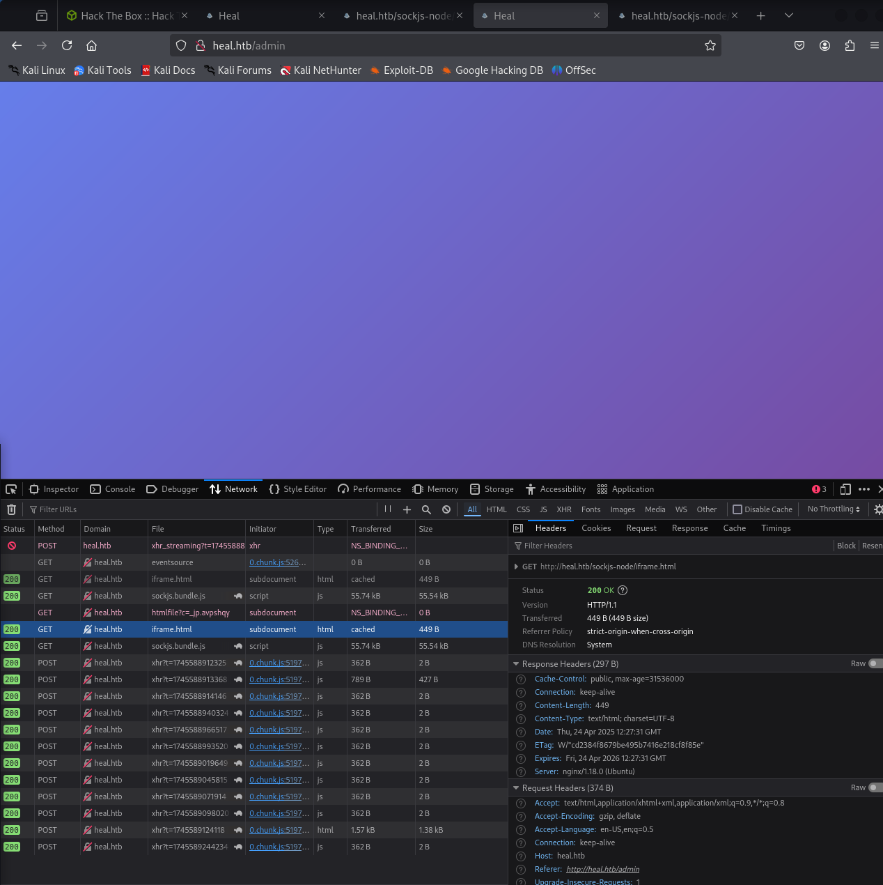
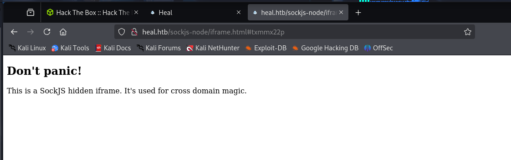

```a["
{
    \"type\":\"hot\"
}",
"{
    \"type\":\"log-level\",
    \"data\":\"none\"
}",
"{
    \"type\":\"hash\",
    \"data\":\"1cc6c4d7b26c571c326e\"
}",
"{
    \"type\":\"warnings\",
    \"data\":[
        \"./src/components/ResumeForm.js\\nModule Warning (from ./node_modules/eslint-loader/index.js):\\n\\n  
        Line 18:10:  'error' is assigned a value but never used     no-unused-vars\\n  Line 23:15:  'response' is 
        assigned a value but never used  no-unused-vars\\n\\n\"]
}"
]
```


Random iframe gefunden - keine ahnung was das soll


