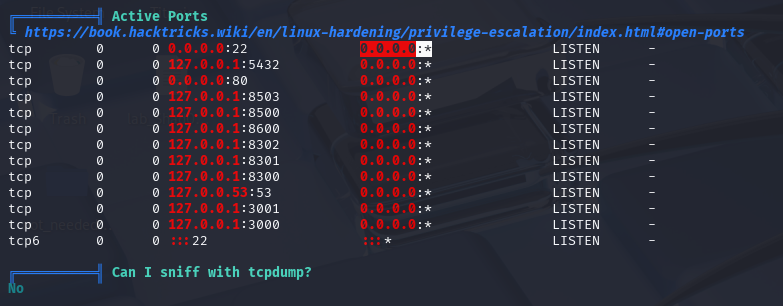
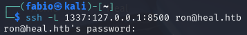
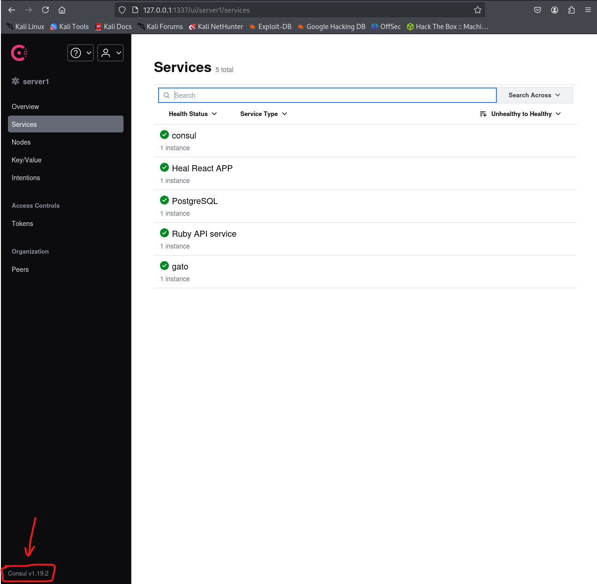

# Root Access

## Active Ports with User


### Local Port Forwarding
```
ssh -L 1337:127.0.0.1:8500 ron@heal.htb

ssh -L <LOCAL PORT>:<REMOTE IP>:<REMOTE PORT> <USER>@<SERVER>
```


- Only response on port 8500


---

### Enumerate Consul

1. Check for exploits on exploit db Version ```v1.19.2```
- Found:
  - https://www.exploit-db.com/exploits/51117

2. Try it


---

Keine Ahnung wie ich das hinbekommen habe


```
http://127.0.0.1:1337/ui/server1/services/Ruby%20API%20service/intentions/create
```


