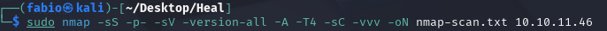
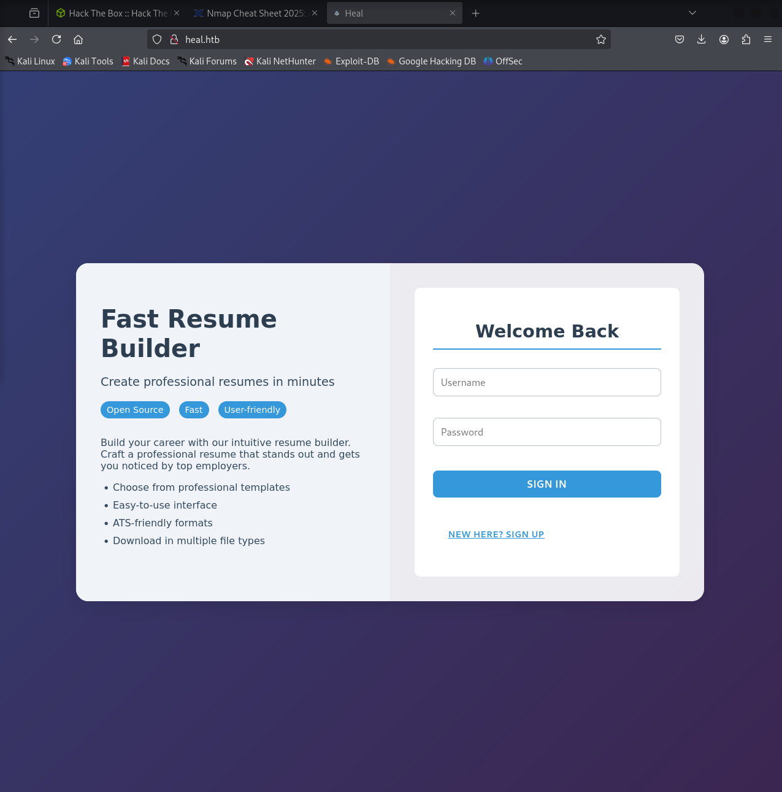
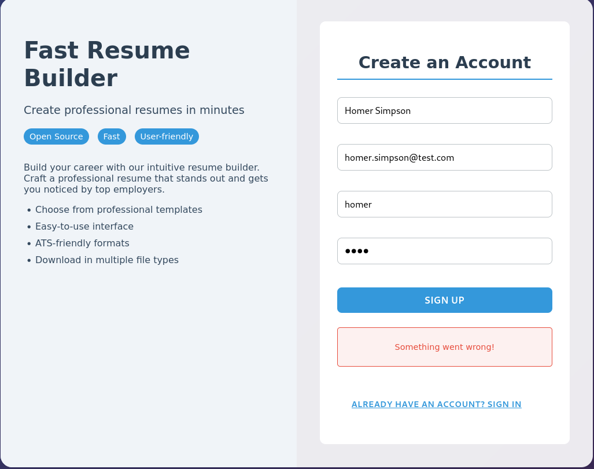
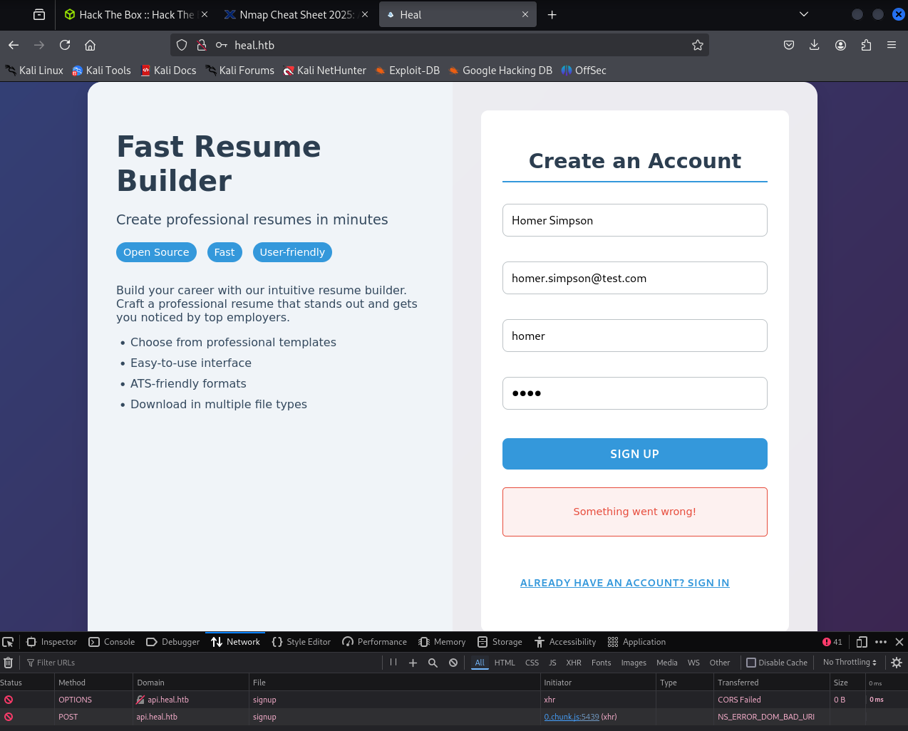
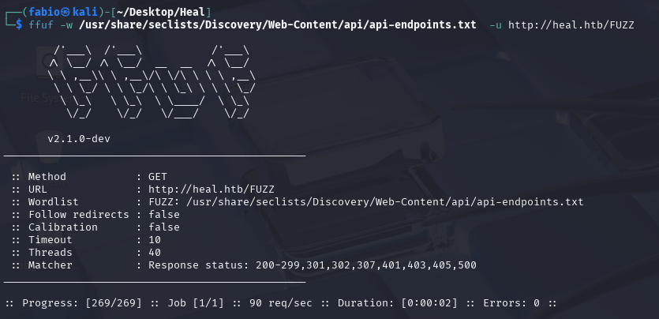
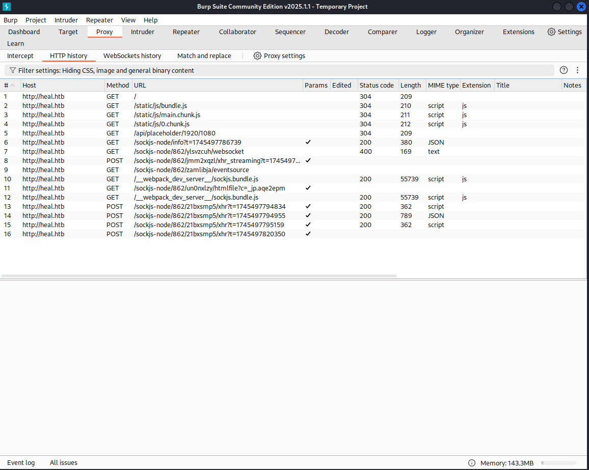
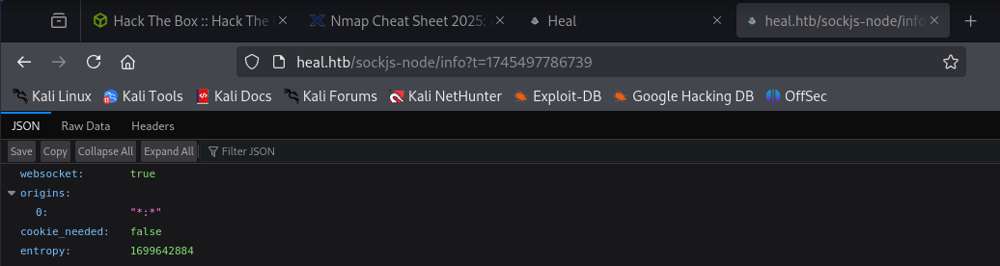
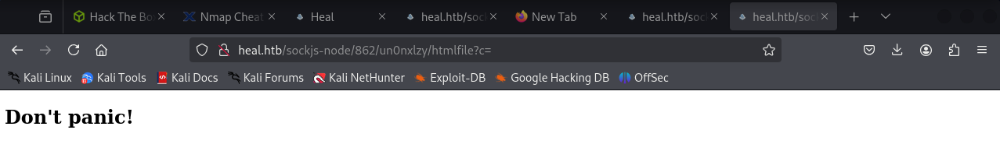

# Reconnaissance (Passive Aufklärung)

## Nmap scan

Nmap:
Command zusammengebaut mit der Hilfe von: https://www.stationx.net/nmap-cheat-sheet/

---
#### Nmap 7.95 scan initiated Thu Apr 24 06:11:59 2025 as: /usr/lib/nmap/nmap -sS -p- -sV -version-all -A -T4 -sC -vvv -oN nmap-scan.txt 10.10.11.46
Nmap scan report for 10.10.11.46
Host is up, received echo-reply ttl 63 (0.028s latency).
Scanned at 2025-04-24 06:11:59 CDT for 43s
Not shown: 65533 closed tcp ports (reset)
PORT   STATE SERVICE REASON         VERSION
22/tcp open  ssh     syn-ack ttl 63 OpenSSH 8.9p1 Ubuntu 3ubuntu0.10 (Ubuntu Linux; protocol 2.0)
| ssh-hostkey: 
|   256 68:af:80:86:6e:61:7e:bf:0b:ea:10:52:d7:7a:94:3d (ECDSA)
| ecdsa-sha2-nistp256 AAAAE2VjZHNhLXNoYTItbmlzdHAyNTYAAAAIbmlzdHAyNTYAAABBBFWKy4neTpMZp5wFROezpCVZeStDXH5gI5zP4XB9UarPr/qBNNViyJsTTIzQkCwYb2GwaKqDZ3s60sEZw362L0o=
|   256 52:f4:8d:f1:c7:85:b6:6f:c6:5f:b2:db:a6:17:68:ae (ED25519)
|_ssh-ed25519 AAAAC3NzaC1lZDI1NTE5AAAAILMCYbmj9e7GtvnDNH/PoXrtZbCxr49qUY8gUwHmvDKU
80/tcp open  http    syn-ack ttl 63 nginx 1.18.0 (Ubuntu)
|_http-title: Did not follow redirect to http://heal.htb/
|_http-server-header: nginx/1.18.0 (Ubuntu)
| http-methods: 
|_  Supported Methods: GET HEAD POST OPTIONS
Device type: general purpose
Running: Linux 5.X
OS CPE: cpe:/o:linux:linux_kernel:5
OS details: Linux 5.0 - 5.14
TCP/IP fingerprint:
OS:SCAN(V=7.95%E=4%D=4/24%OT=22%CT=1%CU=43670%PV=Y%DS=2%DC=T%G=Y%TM=680A1CA
OS:A%P=x86_64-pc-linux-gnu)SEQ(SP=102%GCD=1%ISR=10B%TI=Z%CI=Z%II=I%TS=A)OPS
OS:(O1=M53AST11NW7%O2=M53AST11NW7%O3=M53ANNT11NW7%O4=M53AST11NW7%O5=M53AST1
OS:1NW7%O6=M53AST11)WIN(W1=FE88%W2=FE88%W3=FE88%W4=FE88%W5=FE88%W6=FE88)ECN
OS:(R=Y%DF=Y%T=40%W=FAF0%O=M53ANNSNW7%CC=Y%Q=)T1(R=Y%DF=Y%T=40%S=O%A=S+%F=A
OS:S%RD=0%Q=)T2(R=N)T3(R=N)T4(R=Y%DF=Y%T=40%W=0%S=A%A=Z%F=R%O=%RD=0%Q=)T5(R
OS:=Y%DF=Y%T=40%W=0%S=Z%A=S+%F=AR%O=%RD=0%Q=)T6(R=Y%DF=Y%T=40%W=0%S=A%A=Z%F
OS:=R%O=%RD=0%Q=)T7(R=N)U1(R=Y%DF=N%T=40%IPL=164%UN=0%RIPL=G%RID=G%RIPCK=G%
OS:RUCK=G%RUD=G)IE(R=Y%DFI=N%T=40%CD=S)

Uptime guess: 11.826 days (since Sat Apr 12 10:23:34 2025)
Network Distance: 2 hops
TCP Sequence Prediction: Difficulty=258 (Good luck!)
IP ID Sequence Generation: All zeros
Service Info: OS: Linux; CPE: cpe:/o:linux:linux_kernel

TRACEROUTE (using port 8888/tcp)
HOP RTT      ADDRESS
1   82.87 ms 10.10.16.1
2   21.33 ms 10.10.11.46

Read data files from: /usr/share/nmap
OS and Service detection performed. Please report any incorrect results at https://nmap.org/submit/ .
### Nmap done at Thu Apr 24 06:12:42 2025 -- 1 IP address (1 host up) scanned in 43.74 seconds

---
### => Ergebnis:
- Port 22 (ssh) offen
- Port 80 (http) offen 
  - => Es läuft eine Website auf nginx 1.18.0 (Ubuntu)

---

# Website Enumeration

Account erstellen:

geht nicht:

## Subdomains fuzzen
command zusammengebaut von: https://cheatsheet.haax.fr/web-pentest/tools/ffuf/

- keine endpoints gefunden die man aufrufen kann

## BurpSuite - Requests anschauen

Interessant weil dort Parameter zu sehen sind:

### GET   http://heal.htb/sockjs-node/info?t=1745497786739
Aufruf: 

### GET   http://heal.htb/sockjs-node/862/un0nxlzy/htmlfile?c=_jp.aqe2epm
Aufruf: 

Eine Response wird angezeigt -> Don't panic!

Weiter:
- ausprobieren ob LFI möglich ist und ich so an mehr informationen herankomme

### POST  http://heal.htb/sockjs-node/862/jmm2xqzl/xhr_streaming?t=1745497787461
Aufruf: 
- Ergebnis: 405 Error
