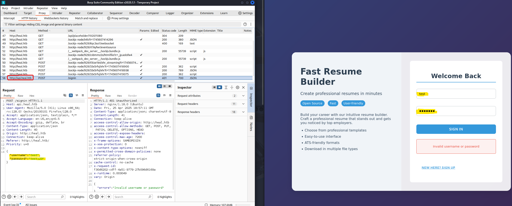
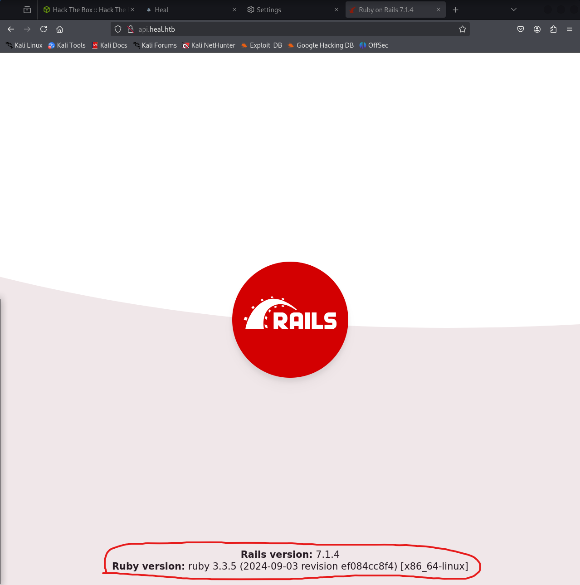

# Subdomain http://api.heal.htb

Gefunden anhand von BurpSuite


## Dummheit
Ich habe den api.heal.htb Pfad relativ früh bei BurpSuite bemerkt, jedoch habe
ich total vergessen diesen in die <code>/etc/hosts</code> Datei einzutragen und habe mich dann
viel zu lange mit allem anderen befasst und mich gewundert warum es nicht geht.
Die genaue Anzahl an Stunden die ich damit verschwendet habe will ich nicht nennen xD
---

# Whatweb Scan http://api.heal.htb
```
Command:

whatweb http://api.heal.htb
```
```
Result:

http://api.heal.htb [200 OK] 
Country[RESERVED][ZZ],
HTML5,
HTTPServer[Ubuntu Linux][nginx/1.18.0 (Ubuntu)], 
IP[10.10.11.46],
Title[Ruby on Rails 7.1.4], 
UncommonHeaders[
    x-content-type-options,
    x-permitted-cross-domain-policies,
    referrer-policy,
    x-request-id
], 
X-Frame-Options[SAMEORIGIN], 
X-XSS-Protection[0], 
nginx[1.18.0]
```
## Ergebnis:
- API in Ruby mit dem Framework Rails geschrieben wurde in der Version 7.1.4
---


# Nikto Scan http://api.heal.htb


```
Command:

nikto -h http://api.heal.htb -C -output nikto-scan-api.txt
```
```
Result:

- Nikto v2.5.0
---------------------------------------------------------------------------
+ Target IP:          10.10.11.46
+ Target Hostname:    api.heal.htb
+ Target Port:        80
+ Start Time:         2025-04-26 07:39:19 (GMT-5)
---------------------------------------------------------------------------
+ Server: nginx/1.18.0 (Ubuntu)
+ /: Uncommon header 'x-runtime' found, with contents: 0.003180.
+ /: Uncommon header 'x-request-id' found, with contents: 8c2164dd-74c3-4364-bd2b-54dd463a1bb0.
+ /yhWIIevN.PRINT: The X-Content-Type-Options header is not set. This could allow the user agent to render the content of the site in a different fashion to the MIME type. See: https://www.netsparker.com/web-vulnerability-scanner/vulnerabilities/missing-content-type-header/
+ nginx/1.18.0 appears to be outdated (current is at least 1.20.1).
+ 8830 requests: 0 error(s) and 4 item(s) reported on remote host
+ End Time:           2025-04-26 08:00:53 (GMT-5) (1294 seconds)
---------------------------------------------------------------------------
+ 1 host(s) tested
```
## Ergebnis:
- Nichts relevantes
---

# dirb Scan http://api.heal.htb

```
Command:

dirb http://api.heal.htb
```
```
Result:

-----------------
DIRB v2.22    
By The Dark Raver
-----------------

START_TIME: Sat Apr 26 08:14:34 2025
URL_BASE: http://api.heal.htb/
WORDLIST_FILES: /usr/share/dirb/wordlists/common.txt

-----------------

GENERATED WORDS: 4612                                                          

---- Scanning URL: http://api.heal.htb/ ----
+ http://api.heal.htb/download (CODE:401|SIZE:26)                                                                                                          
+ http://api.heal.htb/profile (CODE:401|SIZE:26)                                                                                                           
+ http://api.heal.htb/resume (CODE:401|SIZE:26)                                                                                                            
+ http://api.heal.htb/robots.txt (CODE:200|SIZE:99)                                                                                                        
                                                                                                                                                           
-----------------
END_TIME: Sat Apr 26 08:37:35 2025
DOWNLOADED: 4612 - FOUND: 4
```
## Ergebnis:
- Keine relevanten Informationen unter diesen Pfaden gefunden
---

# Website Enumeration


## Ergebnis:
- Ruby version: ruby 3.3.5 (2024-09-03 revision ef084cc8f4) [x86_64-linux]
- Rails version: 7.1.4
---