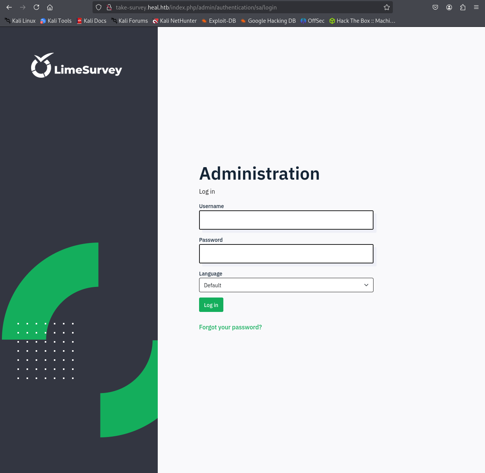

# Subdomain http://take-survey.heal.htb

Unter dem Punkt 'Survey' wird man weitergeleitet auf: http://heal.htb/survey


Sobald man auf 'Take the survey' klickt wird man auf eine weitere Subdomain weitergeleitet, welche man wieder in die
<code>/etc/hosts</code> eintragen muss


Sobald eingetragen:


```
http://take-survey.heal.htb/index.php/552933?lang=en
```
## Ergebnis:
- Die Survey Seite ist in PHP geschrieben

---

## Manuelle suche
- Pfad ausprobieren: http://take-survey.heal.htb/index.php ohne die Survey id
- Admin User herausgefunden


---

# Whatweb Scan http://take-survey.heal.htb
```
Command:

whatweb http://take-survey.heal.htb
```

```
Result:

http://take-survey.heal.htb/ [200 OK] 
Cookies[LS-ZNIDJBOXUNKXWTIP], 
Country[RESERVED][ZZ],
Email[ralph@heal.htb], 
HTML5,
HTTPServer[Ubuntu Linux][nginx/1.18.0 (Ubuntu)], 
HttpOnly[LS-ZNIDJBOXUNKXWTIP], 
IP[10.10.11.46], 
JQuery, 
Lime-Survey, 
MetaGenerator[LimeSurvey http://www.limesurvey.org], 
Script[text/javascript], 
Title[Survey][Title element contains newline(s)!], 
X-UA-Compatible[IE=edge], 
nginx[1.18.0]
```

## Ergebnis:
- User herausgefunden: Email [ralph@heal.htb]
---

# Nikto Scan http://take-survey.heal.htb


```
Command:

nikto -h http://take-survey.heal.htb -C -output nikto-scan-survey.txt
```
```
Result:
- Nikto v2.5.0
---------------------------------------------------------------------------
+ Target IP:          10.10.11.46
+ Target Hostname:    take-survey.heal.htb
+ Target Port:        80
+ Start Time:         2025-04-26 07:39:48 (GMT-5)
---------------------------------------------------------------------------
+ Server: nginx/1.18.0 (Ubuntu)
+ /: The anti-clickjacking X-Frame-Options header is not present. See: https://developer.mozilla.org/en-US/docs/Web/HTTP/Headers/X-Frame-Options
+ /: The X-Content-Type-Options header is not set. This could allow the user agent to render the content of the site in a different fashion to the MIME type. See: https://www.netsparker.com/web-vulnerability-scanner/vulnerabilities/missing-content-type-header/
+ nginx/1.18.0 appears to be outdated (current is at least 1.20.1).
+ /netget: A database error may reveal internal details about the running database.
+ /README.md: Readme Found.
+ 8831 requests: 0 error(s) and 5 item(s) reported on remote host
+ End Time:           2025-04-26 07:57:31 (GMT-5) (1063 seconds)
---------------------------------------------------------------------------
+ 1 host(s) tested
```

## Ergebnis:
- /netget: A database error may reveal internal details about the running database.
- /README.md: Readme Found.
  - ist nicht relevant, da sie von limesurvey ist und nichts mit der Website zu tun hat
---


## dirb Scan Survey
```
Command:

dirb http://take-survey.heal.htb
```
```
Result:

-----------------
DIRB v2.22    
By The Dark Raver
-----------------

START_TIME: Sat Apr 26 08:14:45 2025
URL_BASE: http://take-survey.heal.htb/
WORDLIST_FILES: /usr/share/dirb/wordlists/common.txt

-----------------

GENERATED WORDS: 4612                                                          

---- Scanning URL: http://take-survey.heal.htb/ ----
==> DIRECTORY: http://take-survey.heal.htb/admin/                                                                                                         
+ http://take-survey.heal.htb/Admin (CODE:302|SIZE:0)                                                                                                     
==> DIRECTORY: http://take-survey.heal.htb/application/                                                                                                   
==> DIRECTORY: http://take-survey.heal.htb/assets/                                                                                                        
==> DIRECTORY: http://take-survey.heal.htb/docs/                                                                                                          
==> DIRECTORY: http://take-survey.heal.htb/editor/                                                                                                        
+ http://take-survey.heal.htb/index.php (CODE:200|SIZE:75816)                                                                                             
==> DIRECTORY: http://take-survey.heal.htb/installer/                                                                                                     
+ http://take-survey.heal.htb/LICENSE (CODE:200|SIZE:49474)                                                                                               
==> DIRECTORY: http://take-survey.heal.htb/locale/                                                                                                        
==> DIRECTORY: http://take-survey.heal.htb/modules/                                                                                                       
==> DIRECTORY: http://take-survey.heal.htb/plugins/                                                                                                       
+ http://take-survey.heal.htb/surveys (CODE:200|SIZE:75816)                                                                                               
==> DIRECTORY: http://take-survey.heal.htb/themes/                                                                                                        
==> DIRECTORY: http://take-survey.heal.htb/tmp/                                                                                                           
==> DIRECTORY: http://take-survey.heal.htb/upload/                                                                                                        
+ http://take-survey.heal.htb/uploader (CODE:401|SIZE:4569)                                                                                               
==> DIRECTORY: http://take-survey.heal.htb/vendor/                                                                                                        
                                                                                                                                                          
---- Entering directory: http://take-survey.heal.htb/admin/ ----
+ http://take-survey.heal.htb/admin/admin.php (CODE:302|SIZE:0)                                                                                           
+ http://take-survey.heal.htb/admin/authentication (CODE:200|SIZE:18664)                                                                                  
+ http://take-survey.heal.htb/admin/index.php (CODE:302|SIZE:0)                                                                                           
                                                                                                                                                          
---- Entering directory: http://take-survey.heal.htb/application/ ----
==> DIRECTORY: http://take-survey.heal.htb/application/config/                                                                                            
==> DIRECTORY: http://take-survey.heal.htb/application/controllers/                                                                                       
==> DIRECTORY: http://take-survey.heal.htb/application/core/                                                                                              
==> DIRECTORY: http://take-survey.heal.htb/application/errors/                                                                                            
==> DIRECTORY: http://take-survey.heal.htb/application/extensions/                                                                                        
+ http://take-survey.heal.htb/application/favicon.ico (CODE:200|SIZE:1150)                                                                                
==> DIRECTORY: http://take-survey.heal.htb/application/helpers/                                                                                           
+ http://take-survey.heal.htb/application/index.html (CODE:200|SIZE:114)                                                                                  
==> DIRECTORY: http://take-survey.heal.htb/application/libraries/                                                                                         
==> DIRECTORY: http://take-survey.heal.htb/application/logs/                                                                                              
==> DIRECTORY: http://take-survey.heal.htb/application/models/                                                                                            
==> DIRECTORY: http://take-survey.heal.htb/application/views/                                                                                             
                                                                                                                                                          
---- Entering directory: http://take-survey.heal.htb/assets/ ----
==> DIRECTORY: http://take-survey.heal.htb/assets/fonts/                                                                                                  
==> DIRECTORY: http://take-survey.heal.htb/assets/images/                                                                                                 
==> DIRECTORY: http://take-survey.heal.htb/assets/packages/                                                                                               
==> DIRECTORY: http://take-survey.heal.htb/assets/scripts/                                                                                                
                                                                                                                                                          
---- Entering directory: http://take-survey.heal.htb/docs/ ----
==> DIRECTORY: http://take-survey.heal.htb/docs/themes/                                                                                                   
                                                                                                                                                          
---- Entering directory: http://take-survey.heal.htb/editor/ ----
                                                                                                                                                          
---- Entering directory: http://take-survey.heal.htb/installer/ ----
(!) WARNING: All responses for this directory seem to be CODE = 500.                                                                                      
    (Use mode '-w' if you want to scan it anyway)
                                                                                                                                                          
---- Entering directory: http://take-survey.heal.htb/locale/ ----
==> DIRECTORY: http://take-survey.heal.htb/locale/_template/                                                                                              
==> DIRECTORY: http://take-survey.heal.htb/locale/af/                                                                                                     
==> DIRECTORY: http://take-survey.heal.htb/locale/am/                                                                                                     
==> DIRECTORY: http://take-survey.heal.htb/locale/ar/                                                                                                     
==> DIRECTORY: http://take-survey.heal.htb/locale/az/                                                                                                     
==> DIRECTORY: http://take-survey.heal.htb/locale/be/                                                                                                     
==> DIRECTORY: http://take-survey.heal.htb/locale/bg/                                                                                                     
==> DIRECTORY: http://take-survey.heal.htb/locale/bs/                                                                                                     
==> DIRECTORY: http://take-survey.heal.htb/locale/ca/                                                                                                     
==> DIRECTORY: http://take-survey.heal.htb/locale/cs/                                                                                                     
==> DIRECTORY: http://take-survey.heal.htb/locale/cy/                                                                                                     
==> DIRECTORY: http://take-survey.heal.htb/locale/da/                                                                                                     
==> DIRECTORY: http://take-survey.heal.htb/locale/de/                                                                                                     
==> DIRECTORY: http://take-survey.heal.htb/locale/el/                                                                                                     
==> DIRECTORY: http://take-survey.heal.htb/locale/en/                                                                                                     
==> DIRECTORY: http://take-survey.heal.htb/locale/es/                                                                                                     
==> DIRECTORY: http://take-survey.heal.htb/locale/et/                                                                                                     
==> DIRECTORY: http://take-survey.heal.htb/locale/eu/                                                                                                     
==> DIRECTORY: http://take-survey.heal.htb/locale/fa/                                                                                                     
==> DIRECTORY: http://take-survey.heal.htb/locale/fi/                                                                                                     
==> DIRECTORY: http://take-survey.heal.htb/locale/fr/                                                                                                     
==> DIRECTORY: http://take-survey.heal.htb/locale/ga/                                                                                                     
==> DIRECTORY: http://take-survey.heal.htb/locale/gl/                                                                                                     
==> DIRECTORY: http://take-survey.heal.htb/locale/hi/                                                                                                     
==> DIRECTORY: http://take-survey.heal.htb/locale/hr/                                                                                                     
==> DIRECTORY: http://take-survey.heal.htb/locale/hu/                                                                                                     
==> DIRECTORY: http://take-survey.heal.htb/locale/id/                                                                                                     
+ http://take-survey.heal.htb/locale/index.html (CODE:200|SIZE:0)                                                                                         
==> DIRECTORY: http://take-survey.heal.htb/locale/is/                                                                                                     
==> DIRECTORY: http://take-survey.heal.htb/locale/it/                                                                                                     
==> DIRECTORY: http://take-survey.heal.htb/locale/ja/                                                                                                     
==> DIRECTORY: http://take-survey.heal.htb/locale/ko/                                                                                                     
==> DIRECTORY: http://take-survey.heal.htb/locale/lt/                                                                                                     
==> DIRECTORY: http://take-survey.heal.htb/locale/lv/                                                                                                     
==> DIRECTORY: http://take-survey.heal.htb/locale/mk/                                                                                                     
==> DIRECTORY: http://take-survey.heal.htb/locale/ml/                                                                                                     
==> DIRECTORY: http://take-survey.heal.htb/locale/ms/                                                                                                     
==> DIRECTORY: http://take-survey.heal.htb/locale/mt/                                                                                                     
==> DIRECTORY: http://take-survey.heal.htb/locale/ne/                                                                                                     
==> DIRECTORY: http://take-survey.heal.htb/locale/nl/                                                                                                     
==> DIRECTORY: http://take-survey.heal.htb/locale/pa/                                                                                                     
==> DIRECTORY: http://take-survey.heal.htb/locale/pl/                                                                                                     
==> DIRECTORY: http://take-survey.heal.htb/locale/ps/                                                                                                     
==> DIRECTORY: http://take-survey.heal.htb/locale/pt/                                                                                                     
==> DIRECTORY: http://take-survey.heal.htb/locale/ro/                                                                                                     
==> DIRECTORY: http://take-survey.heal.htb/locale/ru/                                                                                                     
==> DIRECTORY: http://take-survey.heal.htb/locale/run/                                                                                                    
==> DIRECTORY: http://take-survey.heal.htb/locale/si/                                                                                                     
==> DIRECTORY: http://take-survey.heal.htb/locale/sk/                                                                                                     
==> DIRECTORY: http://take-survey.heal.htb/locale/sl/                                                                                                     
==> DIRECTORY: http://take-survey.heal.htb/locale/so/                                                                                                     
==> DIRECTORY: http://take-survey.heal.htb/locale/sq/                                                                                                     
==> DIRECTORY: http://take-survey.heal.htb/locale/sr/                                                                                                     
==> DIRECTORY: http://take-survey.heal.htb/locale/sv/                                                                                                     
==> DIRECTORY: http://take-survey.heal.htb/locale/te/                                                                                                     
==> DIRECTORY: http://take-survey.heal.htb/locale/th/                                                                                                     
==> DIRECTORY: http://take-survey.heal.htb/locale/tl/                                                                                                     
==> DIRECTORY: http://take-survey.heal.htb/locale/tr/                                                                                                     
==> DIRECTORY: http://take-survey.heal.htb/locale/uk/                                                                                                     
==> DIRECTORY: http://take-survey.heal.htb/locale/vi/                                                                                                     
                                                                                                                                                          
---- Entering directory: http://take-survey.heal.htb/modules/ ----
==> DIRECTORY: http://take-survey.heal.htb/modules/admin/                                                                                                 
==> DIRECTORY: http://take-survey.heal.htb/modules/root/                                                                                                  
                                                                                                                                                          
---- Entering directory: http://take-survey.heal.htb/plugins/ ----
+ http://take-survey.heal.htb/plugins/direct (CODE:400|SIZE:4634)                                                                                         
+ http://take-survey.heal.htb/plugins/index (CODE:302|SIZE:0)                                                                                             
+ http://take-survey.heal.htb/plugins/Index (CODE:302|SIZE:0)                                                                                             
+ http://take-survey.heal.htb/plugins/index.html (CODE:200|SIZE:114)                                                                                      
                                                                                                                                                          
---- Entering directory: http://take-survey.heal.htb/themes/ ----
==> DIRECTORY: http://take-survey.heal.htb/themes/admin/                                                                                                  
==> DIRECTORY: http://take-survey.heal.htb/themes/question/                                                                                               
==> DIRECTORY: http://take-survey.heal.htb/themes/survey/                                                                                                 
                                                                                                                                                          
---- Entering directory: http://take-survey.heal.htb/tmp/ ----
==> DIRECTORY: http://take-survey.heal.htb/tmp/assets/                                                                                                    
+ http://take-survey.heal.htb/tmp/index.html (CODE:200|SIZE:255)                                                                                          
==> DIRECTORY: http://take-survey.heal.htb/tmp/upload/                                                                                                    
                                                                                                                                                          
---- Entering directory: http://take-survey.heal.htb/upload/ ----
==> DIRECTORY: http://take-survey.heal.htb/upload/global/                                                                                                 
==> DIRECTORY: http://take-survey.heal.htb/upload/labels/                                                                                                 
==> DIRECTORY: http://take-survey.heal.htb/upload/plugins/                                                                                                
==> DIRECTORY: http://take-survey.heal.htb/upload/surveys/                                                                                                
==> DIRECTORY: http://take-survey.heal.htb/upload/themes/                                                                                                 
                                                                                                                                                          
---- Entering directory: http://take-survey.heal.htb/vendor/ ----
==> DIRECTORY: http://take-survey.heal.htb/vendor/composer/                                                                                               
==> DIRECTORY: http://take-survey.heal.htb/vendor/pear/                                                                                                   
==> DIRECTORY: http://take-survey.heal.htb/vendor/phpmailer/                                                                                              
                                                                                                                                                          
---- Entering directory: http://take-survey.heal.htb/application/config/ ----
+ http://take-survey.heal.htb/application/config/index.html (CODE:200|SIZE:114)                                                                           
==> DIRECTORY: http://take-survey.heal.htb/application/config/rest/                                                                                       
                                                                                                                                                          
---- Entering directory: http://take-survey.heal.htb/application/controllers/ ----
==> DIRECTORY: http://take-survey.heal.htb/application/controllers/admin/                                                                                 
+ http://take-survey.heal.htb/application/controllers/index.html (CODE:200|SIZE:114)                                                                      
==> DIRECTORY: http://take-survey.heal.htb/application/controllers/survey/                                                                                
                                                                                                                                                          
---- Entering directory: http://take-survey.heal.htb/application/core/ ----
==> DIRECTORY: http://take-survey.heal.htb/application/core/db/                                                                                           
==> DIRECTORY: http://take-survey.heal.htb/application/core/plugins/                                                                                      
==> DIRECTORY: http://take-survey.heal.htb/application/core/utils/                                                                                        
==> DIRECTORY: http://take-survey.heal.htb/application/core/web/                                                                                          
                                                                                                                                                          
---- Entering directory: http://take-survey.heal.htb/application/errors/ ----
+ http://take-survey.heal.htb/application/errors/index.html (CODE:200|SIZE:114)                                                                           
                                                                                                                                                          
---- Entering directory: http://take-survey.heal.htb/application/extensions/ ----
==> DIRECTORY: http://take-survey.heal.htb/application/extensions/admin/                                                                                  
                                                                                                                                                          
---- Entering directory: http://take-survey.heal.htb/application/helpers/ ----
==> DIRECTORY: http://take-survey.heal.htb/application/helpers/admin/                                                                                     
==> DIRECTORY: http://take-survey.heal.htb/application/helpers/adodb/                                                                                     
+ http://take-survey.heal.htb/application/helpers/index.html (CODE:200|SIZE:114)                                                                          
==> DIRECTORY: http://take-survey.heal.htb/application/helpers/update/                                                                                    
                                                                                                                                                          
---- Entering directory: http://take-survey.heal.htb/application/libraries/ ----
==> DIRECTORY: http://take-survey.heal.htb/application/libraries/admin/                                                                                   
+ http://take-survey.heal.htb/application/libraries/index.html (CODE:200|SIZE:114)                                                                        
                                                                                                                                                          
---- Entering directory: http://take-survey.heal.htb/application/logs/ ----
+ http://take-survey.heal.htb/application/logs/index.html (CODE:200|SIZE:114)                                                                             
                                                                                                                                                          
---- Entering directory: http://take-survey.heal.htb/application/models/ ----
+ http://take-survey.heal.htb/application/models/index.html (CODE:200|SIZE:118)                                                                           
==> DIRECTORY: http://take-survey.heal.htb/application/models/services/                                                                                   
                                                                                                                                                          
---- Entering directory: http://take-survey.heal.htb/application/views/ ----
==> DIRECTORY: http://take-survey.heal.htb/application/views/admin/                                                                                       
+ http://take-survey.heal.htb/application/views/index.html (CODE:200|SIZE:114)                                                                            
==> DIRECTORY: http://take-survey.heal.htb/application/views/installer/                                                                                   
==> DIRECTORY: http://take-survey.heal.htb/application/views/layouts/                                                                                     
==> DIRECTORY: http://take-survey.heal.htb/application/views/survey/                                                                                      
==> DIRECTORY: http://take-survey.heal.htb/application/views/surveys/                                                                                     
                                                                                                                                                          
---- Entering directory: http://take-survey.heal.htb/assets/fonts/ ----
                                                                                                                                                          
---- Entering directory: http://take-survey.heal.htb/assets/images/ ----
==> DIRECTORY: http://take-survey.heal.htb/assets/images/emoticons/                                                                                       
==> DIRECTORY: http://take-survey.heal.htb/assets/images/screenshots/                                                                                     
                                                                                                                                                          
---- Entering directory: http://take-survey.heal.htb/assets/packages/ ----
==> DIRECTORY: http://take-survey.heal.htb/assets/packages/ckeditor/                                                                                      
==> DIRECTORY: http://take-survey.heal.htb/assets/packages/emailtemplates/                                                                                
==> DIRECTORY: http://take-survey.heal.htb/assets/packages/meta/                                                                                          
==> DIRECTORY: http://take-survey.heal.htb/assets/packages/printable/                                                                                     
==> DIRECTORY: http://take-survey.heal.htb/assets/packages/questions/                                                                                     
                                                                                                                                                          
---- Entering directory: http://take-survey.heal.htb/assets/scripts/ ----
==> DIRECTORY: http://take-survey.heal.htb/assets/scripts/admin/                                                                                          
                                                                                                                                                          
---- Entering directory: http://take-survey.heal.htb/docs/themes/ ----
                                                                                                                                                          
---- Entering directory: http://take-survey.heal.htb/locale/_template/ ----
                                                                                                                                                          
---- Entering directory: http://take-survey.heal.htb/locale/af/ ----
+ http://take-survey.heal.htb/locale/af/index.html (CODE:200|SIZE:0)                                                                                      
                                                                                                                                                          
---- Entering directory: http://take-survey.heal.htb/locale/am/ ----
+ http://take-survey.heal.htb/locale/am/index.html (CODE:200|SIZE:0)                                                                                      
                                                                                                                                                          
---- Entering directory: http://take-survey.heal.htb/locale/ar/ ----
+ http://take-survey.heal.htb/locale/ar/index.html (CODE:200|SIZE:0)                                                                                      
                                                                                                                                                          
---- Entering directory: http://take-survey.heal.htb/locale/az/ ----
+ http://take-survey.heal.htb/locale/az/index.html (CODE:200|SIZE:0)                                                                                      
                                                                                                                                                          
---- Entering directory: http://take-survey.heal.htb/locale/be/ ----
+ http://take-survey.heal.htb/locale/be/index.html (CODE:200|SIZE:0)                                                                                      
                                                                                                                                                          
---- Entering directory: http://take-survey.heal.htb/locale/bg/ ----
+ http://take-survey.heal.htb/locale/bg/index.html (CODE:200|SIZE:0)                                                                                      
                                                                                                                                                          
---- Entering directory: http://take-survey.heal.htb/locale/bs/ ----
+ http://take-survey.heal.htb/locale/bs/index.html (CODE:200|SIZE:0)                                                                                      
                                                                                                                                                          
---- Entering directory: http://take-survey.heal.htb/locale/ca/ ----
+ http://take-survey.heal.htb/locale/ca/index.html (CODE:200|SIZE:0)                                                                                      
                                                                                                                                                          
---- Entering directory: http://take-survey.heal.htb/locale/cs/ ----
+ http://take-survey.heal.htb/locale/cs/index.html (CODE:200|SIZE:0)                                                                                      
                                                                                                                                                          
---- Entering directory: http://take-survey.heal.htb/locale/cy/ ----
+ http://take-survey.heal.htb/locale/cy/index.html (CODE:200|SIZE:0)                                                                                      
                                                                                                                                                          
---- Entering directory: http://take-survey.heal.htb/locale/da/ ----
+ http://take-survey.heal.htb/locale/da/index.html (CODE:200|SIZE:0)                                                                                      
                                                                                                                                                          
---- Entering directory: http://take-survey.heal.htb/locale/de/ ----
+ http://take-survey.heal.htb/locale/de/index.html (CODE:200|SIZE:0)                                                                                      
                                                                                                                                                          
---- Entering directory: http://take-survey.heal.htb/locale/el/ ----
+ http://take-survey.heal.htb/locale/el/index.html (CODE:200|SIZE:0)                                                                                      
                                                                                                                                                          
---- Entering directory: http://take-survey.heal.htb/locale/en/ ----
^C> Testing: http://take-survey.heal.htb/locale/en/images1 
```

## Ergebnis:
- http://take-survey.heal.htb/admin/ gefunden

- -> wird beim aufruf zu 
```http://take-survey.heal.htb/index.php/admin/authentication/sa/login``` 
weitergeleitet 



---