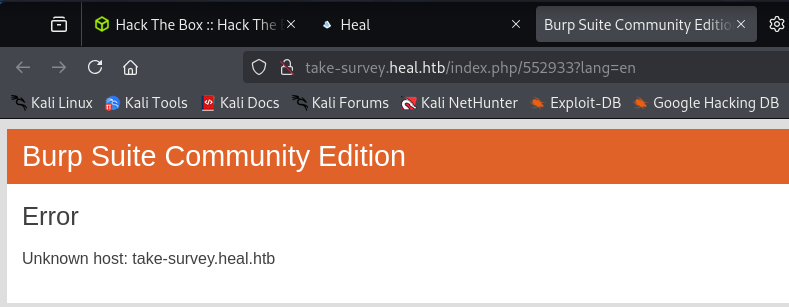
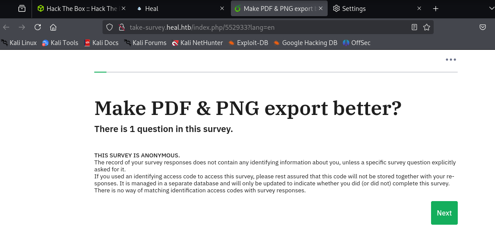
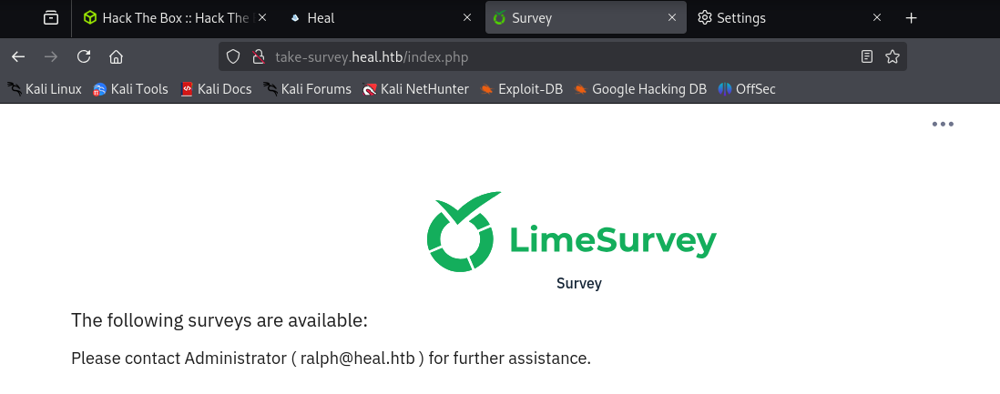
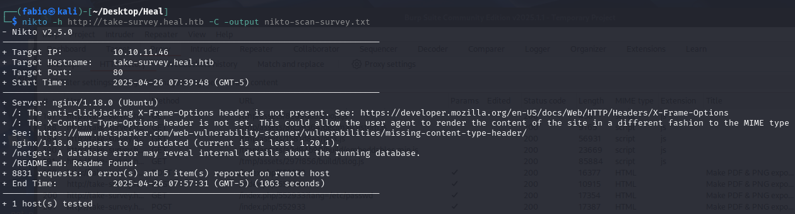

# Subdomain http://take-survey.heal.htb

Unter dem Punkt 'Survey' wird man weitergeleitet auf: http://heal.htb/survey


Sobald man auf 'Take the survey' klickt wird man auf eine weitere Subdomain weitergeleitet, welche man wieder in die
<code>/etc/hosts</code> eintragen muss



Sobald eingetragen:



## Ergebnis:
- Die Survey Seite ist in PHP geschrieben

---

## Manuelle suche
- Pfad ausprobieren: http://take-survey.heal.htb/index.php
- Admin User herausgefunden


---

# Whatweb Scan http://take-survey.heal.htb
```
Command:

whatweb http://take-survey.heal.htb
```

```
Result:

http://take-survey.heal.htb/ [200 OK] 
Cookies[LS-ZNIDJBOXUNKXWTIP], 
Country[RESERVED][ZZ],
Email[ralph@heal.htb], 
HTML5,
HTTPServer[Ubuntu Linux][nginx/1.18.0 (Ubuntu)], 
HttpOnly[LS-ZNIDJBOXUNKXWTIP], 
IP[10.10.11.46], 
JQuery, 
Lime-Survey, 
MetaGenerator[LimeSurvey http://www.limesurvey.org], 
Script[text/javascript], 
Title[Survey][Title element contains newline(s)!], 
X-UA-Compatible[IE=edge], 
nginx[1.18.0]
```

## Ergebnis:
- User herausgefunden: Email [ralph@heal.htb]
---

# Nikto Scan http://take-survey.heal.htb


```
Command:

nikto -h http://take-survey.heal.htb -C -output nikto-scan-survey.txt
```
```
Result:
- Nikto v2.5.0
---------------------------------------------------------------------------
+ Target IP:          10.10.11.46
+ Target Hostname:    take-survey.heal.htb
+ Target Port:        80
+ Start Time:         2025-04-26 07:39:48 (GMT-5)
---------------------------------------------------------------------------
+ Server: nginx/1.18.0 (Ubuntu)
+ /: The anti-clickjacking X-Frame-Options header is not present. See: https://developer.mozilla.org/en-US/docs/Web/HTTP/Headers/X-Frame-Options
+ /: The X-Content-Type-Options header is not set. This could allow the user agent to render the content of the site in a different fashion to the MIME type. See: https://www.netsparker.com/web-vulnerability-scanner/vulnerabilities/missing-content-type-header/
+ nginx/1.18.0 appears to be outdated (current is at least 1.20.1).
+ /netget: A database error may reveal internal details about the running database.
+ /README.md: Readme Found.
+ 8831 requests: 0 error(s) and 5 item(s) reported on remote host
+ End Time:           2025-04-26 07:57:31 (GMT-5) (1063 seconds)
---------------------------------------------------------------------------
+ 1 host(s) tested
```

## Ergebnis:
- /netget: A database error may reveal internal details about the running database.
- /README.md: Readme Found.
  - ist nicht relevant, da sie von limesurvey ist und nichts mit der Website zu tun hat
---


## dirb Scan Survey
```
Command:

dirb http://take-survey.heal.htb
```
```
Result:


```

## Ergebnis:
- t
---