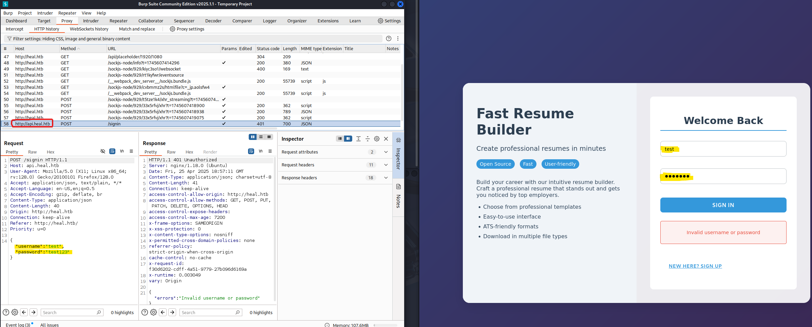
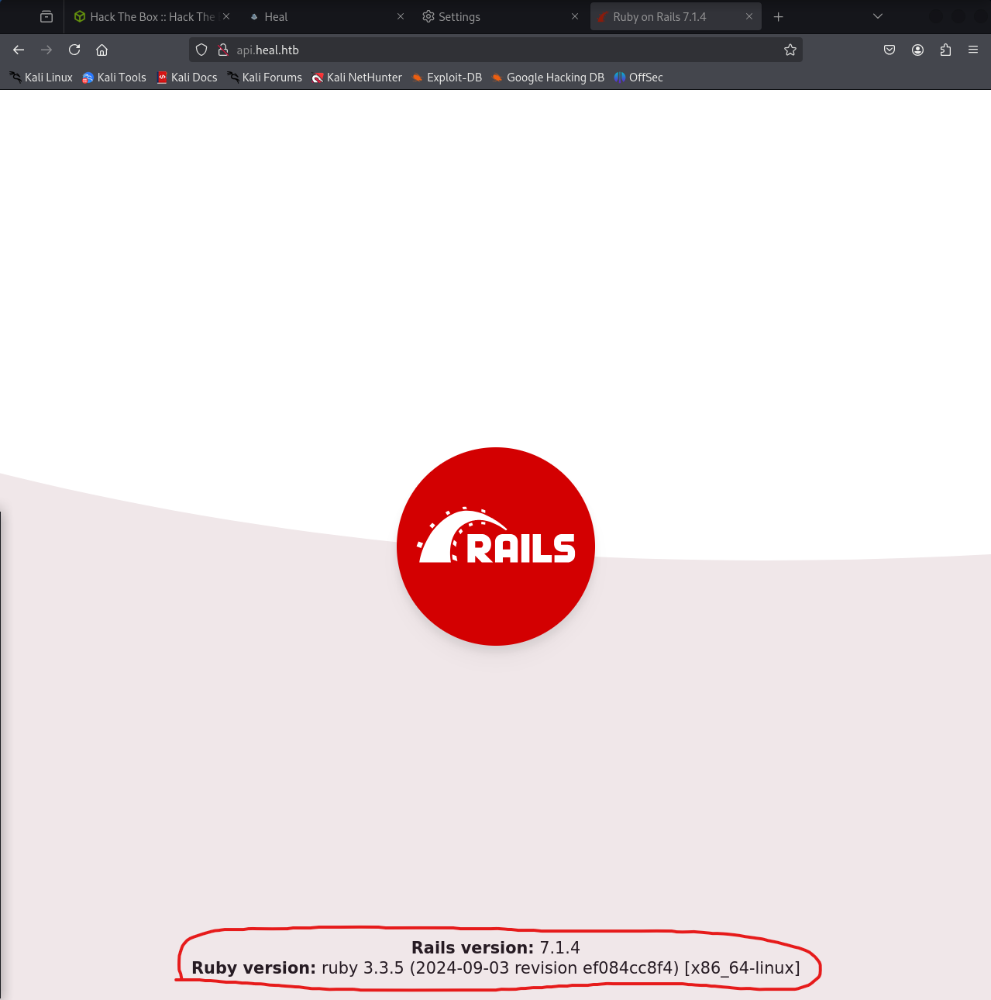
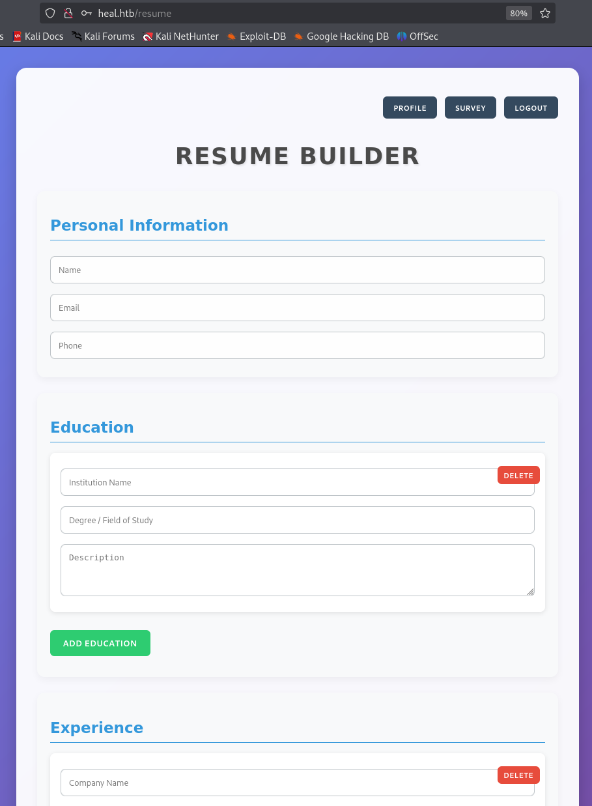
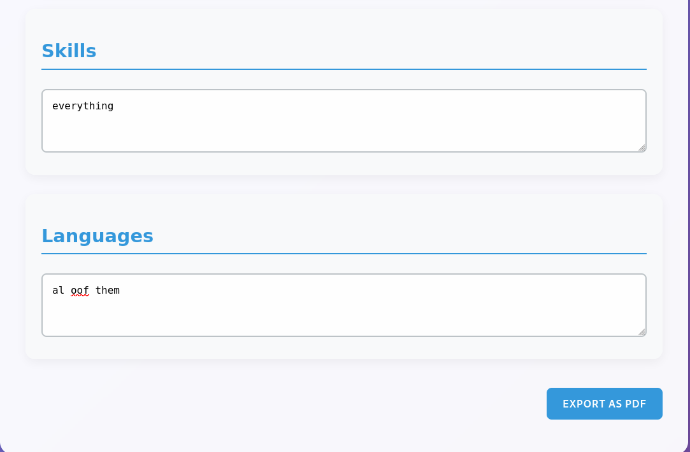
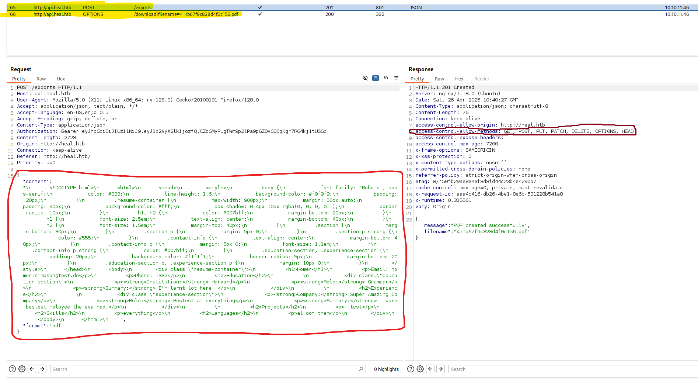
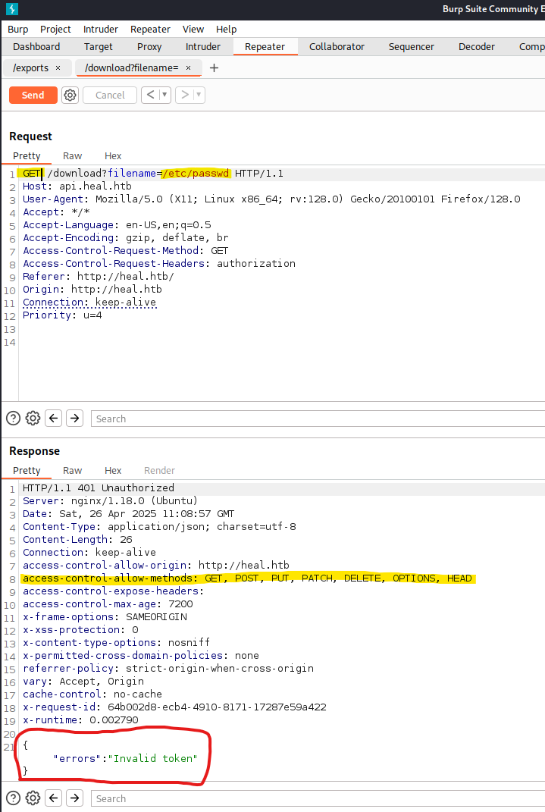
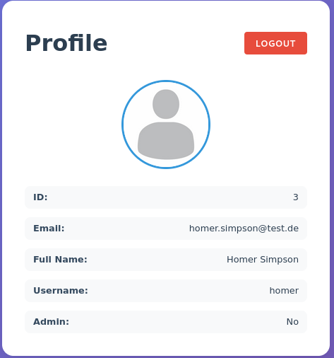
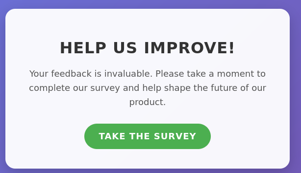
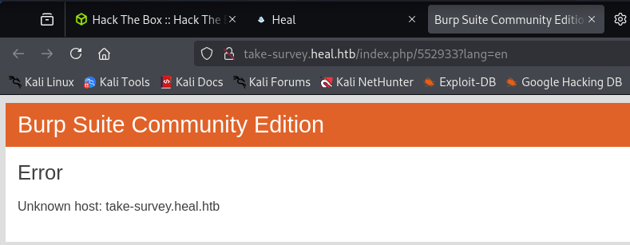
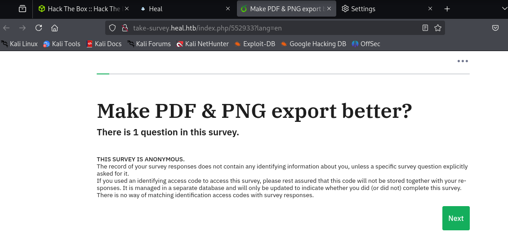

# Subdomain gefunden anhand von BurpSuite

#### Dummheit
Ich habe den api.heal.htb Pfad relativ früh bei BurpSuite bemerkt, jedoch habe
ich total vergessen diesen in die /etc/hosts Datei einzutragen und habe mich dann
viel zu lange mit allem anderen befasst und mich gewundert warum es nicht geht.
Die genaue Anzahl an Stunden die ich damit verschwendet habe will ich nicht nennen xD
---

## Enumeration auf der Subdomain

### Whatweb

```
Command:

whatweb http://api.heal.htb
```
```
Result:

http://api.heal.htb [200 OK] 
Country[RESERVED][ZZ],
HTML5,
HTTPServer[Ubuntu Linux][nginx/1.18.0 (Ubuntu)], 
IP[10.10.11.46],
Title[Ruby on Rails 7.1.4], 
UncommonHeaders[
    x-content-type-options,
    x-permitted-cross-domain-policies,
    referrer-policy,
    x-request-id
], 
X-Frame-Options[SAMEORIGIN], 
X-XSS-Protection[0], 
nginx[1.18.0]
```
#### Neue Erkenntnisse:
- API in Ruby mit dem Framework Rails geschrieben wurde in der Version 7.1.4

---
### Aufrufen der Subdomain

- Ruby version: ruby 3.3.5 (2024-09-03 revision ef084cc8f4) [x86_64-linux]
- Rails version: 7.1.4
---

### Eigenen Account erstellt und Daten eingeben + als pdf exportieren





```
Request:

{
    "content":"\n      
    <!DOCTYPE html>\n
        <html>\n
            <head>\n
                <style>
                    \n body {
                        \n font-family: 'Roboto', sans-serif;
                        \n color: #333;
                        \n line-height: 1.6;
                        \n background-color: #f9f9f9;
                        \n padding: 20px;
                        \n
                    }

                    \n .resume-container {
                        \n max-width: 900px;
                        \n margin: 50px auto;
                        \n padding: 40px;
                        \n background-color: #fff;
                        \n box-shadow: 0 4px 10px rgba(0, 0, 0, 0.1);
                        \n border-radius: 10px;
                        \n
                    }

                    \n h1, h2 {
                        \n color: #007bff;
                        \n margin-bottom: 20px;
                        \n
                    }

                    \n h1 {
                        \n font-size: 2.5em;
                        \n text-align: center;
                        \n margin-bottom: 40px;
                        \n
                    }

                    \n h2 {
                        \n font-size: 1.5em;
                        \n margin-top: 40px;
                        \n
                    }

                    \n .section {
                        \n margin-bottom: 30px;
                        \n
                    }

                    \n .section p {
                        \n margin: 5px 0;
                        \n
                    }

                    \n .section p strong {
                        \n color: #555;
                        \n
                    }

                    \n .contact-info {
                        \n text-align: center;
                        \n margin-bottom: 40px;
                        \n
                    }

                    \n .contact-info p {
                        \n margin: 5px 0;
                        \n font-size: 1.1em;
                        \n
                    }

                    \n .contact-info p strong {
                        \n color: #007bff;
                        \n
                    }

                    \n .education-section, .experience-section {
                        \n padding: 20px;
                        \n background-color: #f1f1f1;
                        \n border-radius: 5px;
                        \n margin-bottom: 20px;
                        \n
                    }

                    \n .education-section p, .experience-section p {
                        \n margin: 10px 0;
                        \n
                    }

                    \n        
                </style>
                \n
            </head>
            \n
            <body>\n
                <div class=\"resume-container\">\n 
                    <h1>Homer</h1>\n 
                    <p>Email: homer.simpson@test.de</p>\n 
                    <p>Phone: 1337</p>\n 
                    <h2>Education</h2>\n 
                    \n
                
                    <div class=\"education-section\">\n 
                        <p><strong>Institution:</strong> Harvard </p>\n 
                        <p><strong>Role:</strong> Gramaar</p>\n
                        <p><strong>Summary:</strong> I'm lernt lot here </p>\n
                    </div>
                
                    \n \n
                 
                    <h2>Experience</h2>\n \n
                    <div class=\"experience-section\">\n 
                        <p><strong>Company:</strong> Super Amazing Company</p>\n 
                        <p><strong>Role:</strong> Bestest at everything</p>\n 
                        <p><strong>Summary:</strong> I ware bestest mployee the eva had.</p>\n
                    </div>
                
                    \n \n
                 
                    <h2>Projects</h2>\n 
                    <p>- test</p>\n 
                
                    <h2>Skills</h2>\n 
                    <p>everything</p>\n 
                
                    <h2>Languages</h2>\n 
                    <p>al oof them</p>\n
                </div>
            \n
            </body>
            \n
        </html>\n    ",
    "format":"pdf"
}
```

```
Response:

{
    "message":"PDF created successfully",
    "filename":"411b67f9c828d4f0c156.pdf"
}
```
---

### Neue Interessante Pfade:
#### OPTIONS http://api.heal.htb/download?filename=411b67f9c828d4f0c156.pdf
#### POST http://api.heal.htb/exports

Durch den Response der beiden kann ich im Header sehen, dass alle HTTP Verben erlaubt sind. <br>
=> Ich versuche erstmal ob ich über eine LFI die <code>/etc/passwd</code> herunterladen kann.
Vorgehen:
- Über BurpSuite den Request an den Repeater senden und dort die Request manipulieren
    - Header in GET ändern
    - http://api.heal.htb/download?filename=/etc/passwd


```
{
    "errors": "Invalid token"
}
```
<strong>Hat nicht geklappt, weil er als Authentifizierung einen validen Token haben will <br>
=> Ich brauche einen gültigen Token
</strong>

---
#### Profil Seite:



#### Survey Seite:


=> weitere subdomain gefunden => wieder in die <code>/etc/hosts</code> einfügen, damit es aufgelöst werden kann

